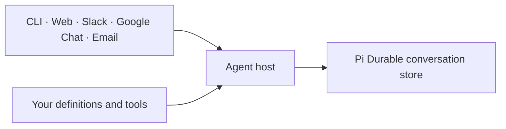

# Dispatch

Build durable AI agents in your own application. Your repository owns the agent
instructions, models, tools and skills. Dispatch provides the runtime and client
libraries; [Pi Durable](https://github.com/earendil-works/pi) owns execution,
recovery and conversation history.

An agent can be one `agent.md` file. Add `agent.ts` only for optional capabilities.
A host process loads those definitions and owns the conversation store.
CLI, Web and channel connectors interact with that owner. Add another
client by using the same conversation operations.



Install the library, write the definitions, and start the host. There is no
scaffold, generated agent layer or build-time instruction merge. Updating the
Dispatch dependency changes the runtime; your definition files stay yours.
See the [minimal agent example](packages/runner/README.md#try-it-without-credentials)
and the [service/client contract](packages/runner/docs/service.md#shared-clients-and-company-compositions).

**Source alpha.** Install the runtime in your own application with Node 24.22.1 or newer and npm:

```sh
npm install https://github.com/dispatchlabs-ai/dispatch/releases/download/v0.13.1/dispatch-runner-0.13.1.tgz
```

Write one `agent.md` with its description, model and instructions, then start
`npx dispatch serve`. In another terminal, `npx dispatch chat` connects to the
same host. The [quickstart](docs/quickstart.md) includes the complete Markdown
and a credential-free demo. No scaffold, application build or Nix is required.

## Use it with your AI agent

Give your agent this prompt:

> Read https://github.com/dispatchlabs-ai/dispatch/blob/main/docs/quickstart.md and
> complete the local conversation walkthrough in a fresh directory. Install the
> released library, create one agent.md, and use the documented host and chat
> commands with synthetic inference. Verify that the same conversation survives
> a host restart. Report the installed version, platform and observed results.
> Use only the new directory's isolated state; leave existing installations and
> real accounts alone. Stop the host you started when finished.

The walkthrough needs shell and file access, Node and npm. The optional
[browser walkthrough](docs/web-quickstart.md) also needs a browser and builds Web
from source. See the [verification record](docs/qualification.md) for observed
platforms and limits.

## Choose the pieces you need

| Goal | Package |
| --- | --- |
| Define and run durable agents from a CLI or local service | [Runner](packages/runner/README.md) |
| Grade retained work or compare controlled reruns with your own rubric | [Eval](packages/eval/README.md) |
| Browse, steer and stop native conversations | [Web](packages/web/README.md) |
| Embed shared conversation operations in a client | [Backend](packages/backend/README.md) |
| Connect a supported channel | [Slack](packages/slack/README.md), [Google Chat](packages/google-chat/README.md), [Email](packages/email/README.md) |
| Inspect native records without running agents | [Observer](packages/observer/README.md) |
| Use remote storage or outbound workers | [Remote](packages/remote/README.md), [Postgres](packages/postgres/README.md), [Workers](packages/workers/README.md) |
| Place complete runs on replaceable EC2 workers | [Fleet](packages/fleet/README.md) |

Packages can be adopted separately at their documented boundaries. Fleet,
PostgreSQL, Web and channel accounts are optional. Use a single application
dependency tree, or a separately managed runtime for
several definition repositories. Nix packaging is optional; it copies the same
definition files you inspect and edit in source.

## Versions and distribution

The latest release is [v0.13.1](https://github.com/dispatchlabs-ai/dispatch/releases/tag/v0.13.1),
using Pi Durable 1.5.2. Its nine reusable package archives, source manifest and
SHA-256 checksums are attached to the release. These packages are not published
to npm. The [package guide](scripts/README.md) describes archive preparation and
installation in an ordinary external application.

Runner, Backend, Remote, Postgres, Workers, Slack, Google Chat, Email and Fleet
have public package definitions. Install matching packages only as needed.
Web, Observer and Eval remain applications with their own build instructions.
The optional [Nix builder](packages/runner/docs/nix-releases.md) packages complete
application source. It does not generate or merge definitions.

Use [the release guide](.pi/skills/release.md) for publication. Upgrading an
application means changing its dependency/lockfile, checking it and explicitly
restarting its host. Building or publishing source never deploys an installation.

## Boundaries and contributing

Local chat trusts the local account and binds exact loopback Host/Origin. Hosted
Web requires HTTPS and an installation-owned authorization binding covering its
configured runs. The shared service exposes one versioned command and watch protocol. Web supplies
its browser adapter over the common client API. Other clients can connect over a
private Unix socket or authenticated HTTPS. Durable channel delivery uses optional
host extensions with shared input validation. Multi-user grants and machine-principal
enrollment remain future work. Agent tools have their host's actual authority; a
working directory is not a sandbox.

Read the [interface inventory](docs/interfaces.md), [HTTP contract](packages/web/openapi.yaml),
[security policy](SECURITY.md), [contribution guide](CONTRIBUTING.md),
[open-source standards](OSS.md) and [verification record](docs/qualification.md).
Report ordinary bugs in [GitHub Issues](https://github.com/dispatchlabs-ai/dispatch/issues)
and vulnerabilities through [private reporting](SECURITY.md).

Created by Chris Reynolds, cofounder of Dispatch Labs AI. Published by
[Dispatch Labs AI](https://github.com/dispatchlabs-ai) under the [MIT license](LICENSE).
Upstream licenses and attribution remain with their components.
