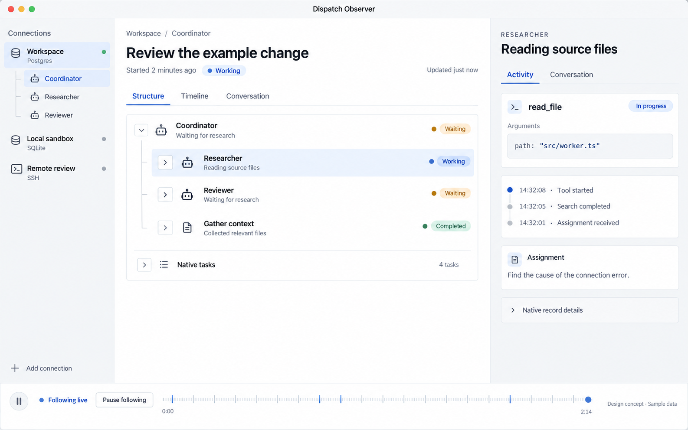
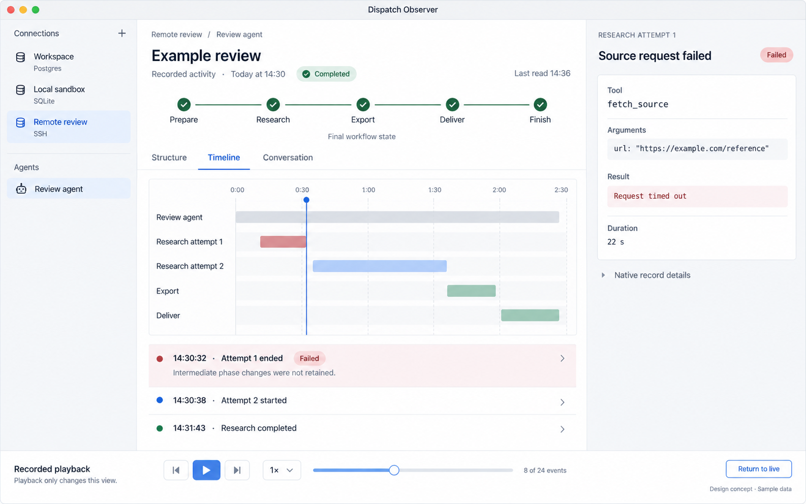
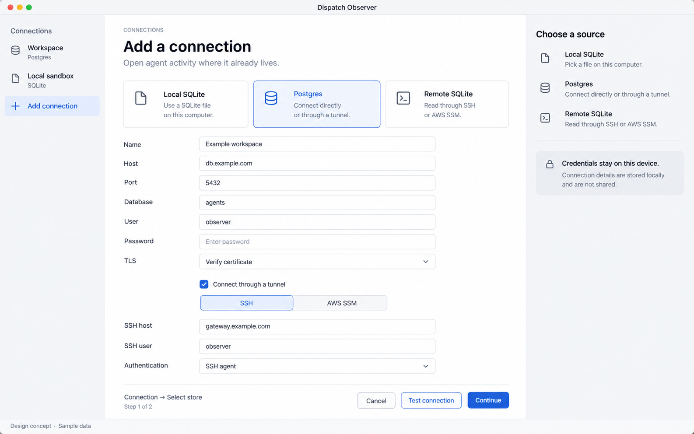

# Dispatch Observer design guide

Dispatch Observer is a local Electron application for understanding Pi Durable
agents while they work and afterward. Start with the activity that matters to a
person: who is working, what they are doing, what they are waiting for, and what
the recorded evidence says happened.

**Implemented design, October 22, 2026.** This guide and the [use cases](USE_CASES.md)
define the product. The Electron implementation now supplies the local/remote
readers and inspection/playback UI. The [usage guide](docs/usage-guide.md) records
qualified paths and remaining platform limits. The [reference images](docs/design/README.md)
remain the original synthetic ImageGen concepts, not runtime captures.

## Product direction

**Workflow-reading refinement, October 28, 2026:** start on **This machine** with
all saved workflows visible and newest recorded activity first. Card and overview
share a consistent workflow name and cycle. An explicit unfinished-only filter
must explain hidden history. Show last recorded activity separately from observation
time; recency applies only to loaded sources. Unrelated conversations remain separate.
Connections and appearance remain in **Settings**, not the everyday work rail.

Workflow → assignment → conversation is the primary route. Group explicit leading
handoff labels only within the same validated installation and Runner namespace.
Native identities and exact sender addresses establish links, not prose or proximity.
A validated local Runner store also discovers immediate sibling agent/session.sqlite
files, including stopped peers. Process discovery covers writable files in Node,
Bun, Deno, Pi, Dispatch and Electron hosts; other hosts require explicit sources.
No recursive crawl, sibling symlink following or transcript
path retrieval is permitted. Validate sibling schema, agent identity and namespace.
Show the known sender → assignment chain and unavailable links near the overview,
with a Settings recovery action. Never draw unrecorded developer/tester stages as facts.

Separate **Execution unknown**, unfinished-task count, **Observer connected** and
**Reported result**. A store's open file handle does not prove model execution.
Recognize only explicit opening verdicts in the latest saved assistant text; otherwise
show its excerpt. Keep assignment results separate from unknown workflow outcomes.
**Read latest response** anchors to the message's beginning; if outside the loaded
or frozen page, open a latest-observation dialog without advancing playback.
**Latest activity** remains deliberate tail-following, not an outcome shortcut.

The approved starting point is the earlier agent-inspector concept: a restrained
white/gray workspace, a clear task hierarchy or timeline, and an adjacent detail
pane. Extend it into a desktop application with saved source connections and
explicit live/playback controls. Retain progressive disclosure for native Pi
records and implementation details.

The first design discussion considered a hosted observer and per-host access.
The selected direction is a desktop client that can read local SQLite, direct or
tunneled Postgres, and remote SQLite through a helper. Central Postgres remains a
particularly convenient source, but is not a prerequisite for observation.

Pi owns durable execution and recovery. Observer owns presentation, source
connections, and a read-only interpretation of retained records. It does not need
an agent definition, model provider, or new telemetry store to inspect ordinary
Pi state. An observer failure must never stop or restart an agent.

## Reference screens

### Live activity



The original reference's left rail selects a source and agent; the current rail
selects This machine or a conversation, with sources managed in Settings.
The center explains the selected work
and its children. The right pane answers what the selected item is doing, with
its assignment and current/recent tool activity. A parent can be waiting while a
child is working. The overall work status can therefore differ from the selected
parent task's status; label that distinction rather than showing conflicting
badges without context. Covers OBS-006 through OBS-010.

### Recorded workflow playback



A workflow can finish successfully after a failed attempt. Selecting that attempt
shows its recorded error without making the whole workflow look failed. The
playhead navigates retained events. A phase strip labeled **Final workflow state**
is separate from the event under inspection; it is not a reconstruction of every
intermediate phase. Covers OBS-009 and OBS-011 through OBS-014.

### Add a connection



Choose **Local SQLite**, **Postgres**, or **Remote SQLite** first. Show only fields
relevant to that source and its selected transport. Postgres store selection
follows a successful connection. Source type and transport are separate concepts:
Postgres can use SSH/SSM, while remote SQLite requires a host-side reader.
Covers OBS-001 through OBS-005.

These images establish composition and visual tone. This guide governs behavior
and copy when a generated image differs. In particular, implemented credential
copy should say **Saved credentials stay on this device**: authentication still
communicates with the selected database or transport peer. Do not duplicate the
connection type explanations in a permanent help column when the selectors
already explain them; contextual help may replace that column on narrower views.

## Information architecture

**Generic journeys, October 28, 2026:** one searchable, collapsible tree handles
native ownership, every retained labelled handoff and optional versioned
[`observer.workflow` documents](docs/workflow-records.md). Containment is distinct
from relationship edges. Rounds, branches, attempts, scopes, turns and passes are
producer labels, not fixed screen types. Shared conversations may provide evidence
for multiple nodes/cycles; exact-entry references preserve their distinct scopes.
Do not infer missing stages, dependencies or results. Retain per-workflow selection,
search and expansion, with a return path from linked workflows. This source exposes
explicit remote/Postgres source records without remote discovery. Document state is
the latest observation, separate from frozen conversation playback.

Keep conversation headers compact, with ancestry and opening details disclosed
on request. The overview lists recorded activities with direct evidence/conversation
actions; selected nodes expose their primary evidence and linked workflow without
opening a disclosure. Exact workflow entries open expanded in the adjacent inspector
(a drawer at 1180 px and narrower), with native records available there. Reading or dismissing
this evidence does not move playback; explicit event navigation returns to playback.
Unmodified arrows expand/collapse journey groups; modified history keys retain
their navigation meaning.

Use four stable areas rather than a collection of dashboards:

1. **Navigation rail:** This machine, conversations in the current source, and
   Settings. Settings contains saved connections with Open, Add, Edit, Reconnect
   and Remove actions, plus the color theme. A source is a selected database/store,
   not necessarily one agent. Keep selections scoped to their source.
2. **Work header:** a human-readable activity title, source/agent breadcrumb,
   recorded start/end information, overall outcome, and last observation time.
3. **Work area and inspector:** Structure, Timeline, and Conversation are alternate
   views of the same selection. Selecting a child, tool, or event opens its detail
   in the inspector without losing context.
4. **Following/playback bar:** makes the current viewing mode explicit and provides
   the controls appropriate to that mode.

There is no universal Pi "run" record across all integrations. A work item may be
a conversation, native task with children, or explicitly recorded workflow. Build
its grouping from those records and label the selected scope; do not invent run
boundaries from idle time or assume every assistant reply is a separate run.

Display concise friendly labels first. Keep source, logical store, conversation,
task, and entry identities available in **Native record details**. Use the complete
source/store/native identity internally; store-local integers are not global IDs.

## Interaction rules

### Following live

- Fetch one consistent snapshot, then observe later commits with short reads.
  Preserve selection and expansion state across refreshes.
- Open new conversations at their assignment context. Live reads continue without
  moving the reader. **Latest activity** opts into tail-following; scrolling away
  or inspecting content stops that movement. **Context** returns to the opening
  context without changing a paused playback boundary.
- Following appends/reveals new activity. Selecting older content or choosing
  **Pause following** stops automatic movement, not the agent or connection.
  Show a count of newer events and an explicit **Return to live** action.
- Do not scroll an inspector away from the text someone is reading. Expanding
  tool output, copying text, or opening native details never changes agent state.
- Status words describe evidence: **Working**, **Waiting**, **Completed**,
  **Failed**, or **Last observed**. Show partial results as partial; a call without
  a saved result is not automatically a failure.

### Recorded playback

- Freeze a selected observation boundary and play through its retained events.
  New live commits do not move the historical playhead or change its event count.
- Provide Play/Pause, previous/next event, a scrubber, speed, and an event counter.
  Keyboard shortcuts operate playback only when focus is outside editable fields.
  Playback speed changes presentation pacing, never model/tool execution.
- Use saved timestamps for elapsed-time displays where available, and deterministic
  record order for navigation. Show unknown timing explicitly. Record identity is
  not proof of wall-clock timing; separate stores do not share a commit sequence.
- An event can update only the state supported by that event's retained evidence.
  Where historical task/document versions are gone, show the recorded event and
  clearly labeled current/final state rather than a fabricated historical frame.
- Keep a visible **Recorded playback** label, with **Return to live** separate from
  Play. Do not use execution language such as "run again", "resume agent", or
  "retry" for viewer controls.

### Structure, tools, and workflows

- Keep Back and Forward visible above the work header, distinct from event
  playback controls. Conversation navigation retains the previous inspection
  tab, filters, selected evidence, and live/paused view; automatic playback stays
  stopped on return. A Parent conversation control follows native ownership.
  History is local to the selected connection and clears when switching sources;
  reconnecting the same source preserves it. Support Alt+Left/Right and Cmd+[/]
  outside editable fields and dialogs.
- Default Structure to an indented tree with thin connectors and collapsible
  branches. Depth, selection, and status should explain relationships without
  turning the screen into a graph editor. Native tasks are an optional disclosure.
- Follow recorded conversation/task ownership for delegation. Custom labels may
  identify an agent, but names and similar timestamps cannot establish parentage.
  Show an unresolved reference as such; do not silently attach it to a local node.
- Tool inspection separates **Arguments**, **Result**, **Error**, and available
  timing. Match model calls and results using recorded call identity. Mark
  truncated/redacted/unavailable fields individually, and preserve multiline text.
- Conversation messages render Markdown paragraphs, headings, lists, tables,
  inline code, and code blocks. Tool calls and results remain separate events
  in recorded order, initially collapsed with a short preview. Expanding a result
  decodes valid JSON text envelopes, preserves indentation and line numbers,
  and exposes other envelope fields separately. Unrecognized structured output
  uses indented JSON. Long command lines wrap within their own panel.
- Use compact grouped disclosures for consecutive tool events, with readable
  operation names and recorded errors. Keep separate calls/results inside them
  in retained order. Calls also expose an identity-matched result disclosure,
  labeled as a later recorded event; missing matches remain unknown. Long requests collapse without losing access to full text.
  Show recorded peer authors rather than calling every user-role message “You.”
  Opening context identifies the agent, sender, assigned phase and original
  handoff when available. Distinguish a requested automatic reply from a received
  reply, and peer messaging from native parent/fork ownership.
- Selecting a tool event during playback opens its transcript row. A call row
  shows its arguments; later results keep their own event. The inspector retains
  the labeled matching result and the original redacted native entry. Formatting
  never changes the saved records or playback boundaries.
- Markdown cannot execute HTML or load remote images. Image references and HTTP(S)
  links use the existing deliberate external-open confirmation; unsupported links
  remain text.
- Versioned producer documents may identify stages, deterministic tasks, retries,
  artifacts and current/final phase through the generic workflow contract.
  Native ownership and handoffs remain useful without those documents. Never
  interpret arbitrary JSON fields as universal workflow semantics.
- Show attempts separately when records establish them. A failure in one child
  does not determine the final workflow outcome. File links indicate whether bytes
  can actually be retrieved, not merely whether a path was recorded.

### Connection lifecycle

Open **Settings → Connections** to manage sources. Settings is a desktop dialog
over the mounted workspace: closing it restores the reading position, expanded
tools, selection and viewing mode. Opening it stops automatic playback without
changing its observation boundary or stopping live reads. Escape closes only the
top dialog; cancelling Add/Edit returns to Settings. Opening the current connected
source returns to its existing view; reconnecting is a separate explicit action.
Removing a saved connection never deletes the agent database. Removing the current
connection returns the workspace to This machine.

Add/Edit uses a wide desktop form with separate transport/database columns. Only
fields scroll: the title, close control and Cancel/Test/Save actions stay visible.
Reveal validation and connection feedback within the scrolling body.

Reading preferences and discovering local stores must not initialize credential
storage. Check it when an operation actually reads or saves a protected password;
report unavailable storage without silently switching to plaintext.

| Source | Setup and read behavior |
| --- | --- |
| Local SQLite | Pick an existing file. Check schema compatibility, open read-only, and use short consistent snapshots. Never create a missing database or take its runner owner lock. |
| Postgres | Enter host/database/user and TLS settings, authenticate, discover only accessible stores, then select one. A manually supplied store ID remains possible when listing is not permitted. Use read-only snapshots and a narrowly granted identity. |
| Postgres over SSH | Authenticate the tunnel host, establish a local loopback forward, then authenticate the database. Preserve verification of the database's actual TLS server identity through the tunnel. |
| Postgres over AWS SSM | Select an existing local AWS profile/credential flow, region, managed target, and supported forwarding destination. Verify transport prerequisites and remote reachability; do not create IAM grants or network exposure automatically. |
| Remote SQLite | Select SSH/SSM, host, and database path. Run or connect to a compatible reader on that host. A tunnel carries the read protocol; opening the live file through a network mount or copying only its main file is not the live-read design. |

**Test connection** validates access and compatibility without starting an agent,
creating tables, or migrating anything. Separate transport, authentication,
database, store, and compatibility errors so the user can fix the right field.

Use saved SSH configuration/agent identities and host-key verification where
available. A changed host identity must remain visible. SSM uses the user's
existing authorization and credential flow. Any helper installation or update
must be explicit and show its destination and version; do not turn opening a
connection into an invisible persistent deployment.

Close only transports/helper processes owned by this viewer. Reconnection uses
fresh snapshots, preserves the selection, and cannot claim work has resumed.
The remote helper protocol, packaging, supported host runtimes, and exact SSM
session method are implementation decisions still to qualify.

## Status and recovery

Keep these three dimensions separate in state and UI:

| Dimension | Examples | What it establishes |
| --- | --- | --- |
| Source connection | Connected, reconnecting, disconnected, permission denied | Whether the viewer can read the source now. |
| Recorded work | Working, waiting, completed, failed, unknown | What the last readable Pi records say. |
| Viewing mode | Following live, following paused, recorded playback | How the local presentation advances. |

Database connectivity is not process presence. If the runner has no independently
observable heartbeat/presence signal, describe a running task as last observed,
with its timestamp. Never turn an elapsed timeout into a claim that the process
died or a tool failed. Presence can later enrich the view without being required
for reading history.

Empty states distinguish **No sources**, **No recorded activity**, **No matches**,
**Unavailable source**, and **Unsupported storage version**. A disconnect keeps
the last readable view with a stale timestamp. A permission error does not display
cached data as newly authorized or broaden access automatically.

## Visual system

Use the reference concept's neutral surfaces and small, purposeful color accents.
No large status dashboard, decorative gradients, glass panels, or glowing graph
nodes are needed. The work and its evidence are the visual focus.

| Token | Light reference | Dark reference | Use |
| --- | --- | --- | --- |
| Canvas | `#ffffff` | `#16191e` | Main workspace |
| Secondary surface | `#f6f7f9` | `#1d2128` | Rail, inspector, grouped controls |
| Primary text | `#202630` | `#ecedf0` | Titles and content |
| Secondary text | `#606b79` | `#a4aebc` | Metadata and supporting labels |
| Border | `#e4e7ec` | `#343a44` | Quiet structural dividers |
| Selection / working | `#2963bc` on `#eef4ff` | `#83b3fc` on `#21334d` | Selected rows, active work, focus |
| Completed | `#287552` on `#edf7f1` | `#8ad4ae` on `#20372e` | Recorded completion |
| Waiting | `#89600e` on `#fbf5e7` | `#e7c375` on `#3b3221` | Recorded wait |
| Failed | `#ac4850` on `#fff0f1` | `#f2a3a8` on `#40282d` | Recorded error |

- Use the system sans-serif stack; Inter is an optional bundled choice subject to
  its license. Use system monospace for identifiers and tool data. Body text starts
  around 13–14 px, supporting text 12 px, pane headings 16 px, work titles 22–24 px.
- Use a 4 px spacing grid, usually 8/12/16/24 px gaps, 6–8 px control/row radii, and
  1 px dividers. Reserve stronger contrast for selection and keyboard focus.
- A navigation rail around 216–240 px and inspector around 340–400 px frame a flexible
  center. Let users resize panes. Keep form widths comfortable; every panel does
  not need a card, border, or shadow.
- Pair color with text/icons. Ensure contrast and focus visibility in the actual
  rendered implementation; the palette table and generated images are not measured
  accessibility evidence. Respect system color scheme and reduced motion.

### Window sizes and keyboard use

**Desktop-only scope, October 28, 2026:** qualify the implementation at 1440×900
and 1280×720. The Electron window has a 900 px minimum width. Phone/mobile layout
qualification is no longer required; this supersedes the earlier 768×1024 and
390×844 acceptance requirement. Existing small-layout styles are not a supported
mobile product. At narrower desktop sizes, details open in a drawer rather than
squeezing the conversation. Long tool commands and output wrap within their panel.

Use platform-native title bars and dialogs; the macOS traffic lights in the
references are not to be drawn on Windows or Linux. Provide tab order, visible
focus, keyboard tree expansion/selection, accessible control labels, and a way to
leave every pane/dialog. Escape closes a transient detail/dialog without stopping
an agent. Do not bind Space/arrow playback shortcuts while typing in fields.

Prefer the existing Dispatch UI primitives where they fit. Before changing the
Web styling contract or extracting shared components, consult that package's
authoritative specification and guidance. This design package neither changes the
Web UI nor makes its component migration part of Observer implementation.

## Storage and process boundaries

The implementation uses this arrangement:

```text
Electron renderer: navigation, hierarchy, timeline, transcript, inspector
          │ narrow, typed IPC; no credentials or arbitrary SQL
Electron background/utility process: source connections and record projection
          ├── local SQLite read-only snapshots
          ├── Postgres read-only snapshots (direct or tunneled)
          └── SSH/SSM → compatible remote SQLite reader
```

The renderer remains isolated from Node and filesystem/database privileges. The
background side owns source validation, query execution, credentials, and tunnels.
Treat stored Markdown, HTML, tool output, terminal escapes, and links as untrusted
data. Never evaluate them or permit them to initiate connections/commands through
IPC. A remote reader exposes the narrow inspection protocol, not arbitrary SQL or
shell execution requested by content.

Database access is operator access. A direct database connection does not inherit
the original chat application's per-user permissions. Explicit source/store scope,
database grants, protected credentials, and provider-state exclusions are part of
the design. Do not promise a hosted application's audience restrictions unless
the chosen read path actually enforces them.

Existing source provides useful foundations:

- [Dispatch's Postgres reader](../web/server/storage/postgres/storage.ts) includes
  `readSnapshot`, which does not acquire executor ownership or open a Harness.
  Its [database layer](../web/server/storage/postgres/database.ts) opens a fixed
  read-only repeatable-read snapshot. Each refresh must open a new short snapshot.
- The [schema](../web/server/storage/postgres/migrations.ts) stores conversations,
  entries, tasks, submissions, documents, and revisions under a logical store ID.
  The per-store commit sequence can signal change; it is not an append-only log
  of every task transition.
- [Runner](../runner/src/runtime.ts) currently opens `session.sqlite` directly.
  Observer can read that existing source without adding a Postgres requirement to
  Runner. Configurable Runner storage is separate work.
- The current web adapter targets Pi Durable 1.1.0 while Runner declares 1.3.0.
  Reuse requires explicit compatibility work; a shared numeric schema version is
  not sufficient qualification. Avoid importing web application startup just to
  get a database reader.

Use supported Pi interfaces and versioned storage contracts where available.
Keep schema-specific reading behind a small compatibility boundary; an extension
or schema mismatch must never trigger migration by the observer.

For live following, check for committed changes and fetch consistent snapshots or
use a reliable source-specific change feed when available. Pi's in-process watch
APIs do not automatically subscribe an unrelated reader to another process's
database writes. UI streaming is a presentation concern, not another scheduler.

### Record fidelity

| Evidence | What the observer may show | Limit |
| --- | --- | --- |
| Immutable conversation entries | Saved messages, recorded tool calls/results, entry order | Not necessarily the exact provider request or every intermediate token. |
| Conversation/task ownership | Native parent/child relationships | Cross-store relationships require explicit evidence. |
| Task records | Latest status/checkpoint, available start/end/outcome data | Updated task rows do not preserve every historical transition. |
| Documents and revisions | Retained workflow state and reconstructible document versions | Bases may replace earlier deltas; retired temporary content may be deleted. |
| Live documents | Current partial activity when retained | A completed run may clear slots; past token streams are not promised. |
| Tool result text and artifact references | Saved output and links with available metadata | Output can be bounded; remote file bytes require their own retrieval path. |

The useful promise is a truthful play-by-play of what remains recorded. It does
not require preserving every ephemeral frame or re-executing historical actions.

## Implementation and qualification

The implementation stays in this package and imports shared UI primitives through
`packages/web/src/components/ui.tsx`. It reads versioned storage records without
importing Web startup or Pi’s execution runtime. The background service owns
connection lifetimes; the renderer receives redacted projections. The generic
workflow view presents native task phase/attempt fields and retained documents;
it does not invent a universal phase strip for arbitrary agent extensions.

Before describing a use case as implemented, record dated evidence against its
`OBS-` identifier. Qualify read-only behavior beside an active owner, disconnected
sources, unsupported schema, incomplete history, and selection across reconnects.
Verify native ownership is untouched and playback never calls tools/providers.
Review real rendered layouts and keyboard flows at the sizes above, then qualify
platform builds and transport/credential behavior individually.

Follow [CONTRIBUTING.md](../../CONTRIBUTING.md): no automated tests under the current
repository policy; source/type/build checks and permitted interactive verification
remain applicable. Do not treat an ImageGen mockup as a rendered application check.
Signed installers, auto-updates, a hosted viewer, and migration of existing agent
deployments are not delivered by this implementation.

## References

- [Electron process model](https://www.electronjs.org/docs/latest/tutorial/process-model)
  and [security guidance](https://www.electronjs.org/docs/latest/tutorial/security)
- [SQLite over a network](https://www.sqlite.org/useovernet.html) and
  [WAL behavior](https://www.sqlite.org/wal.html)
- [Pi Durable source and documentation](https://github.com/earendil-works/pi)
