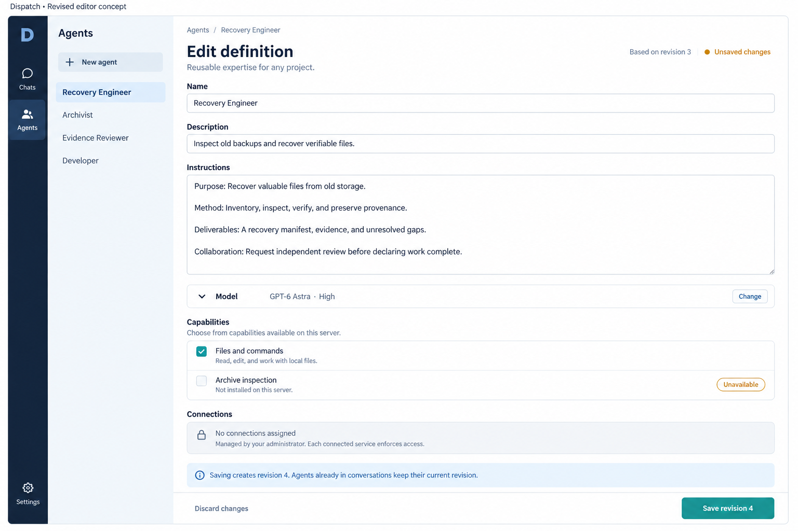
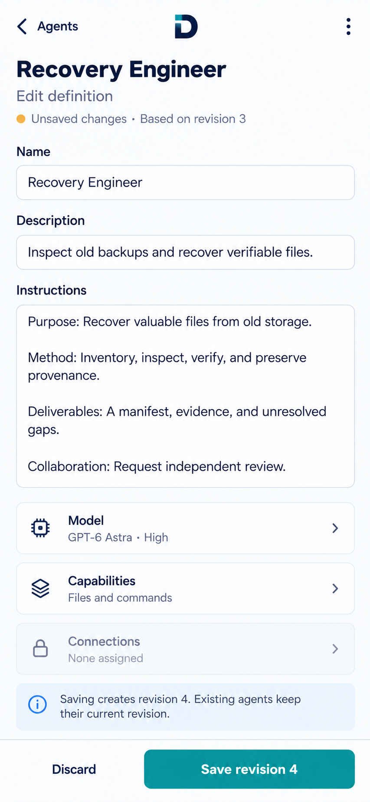
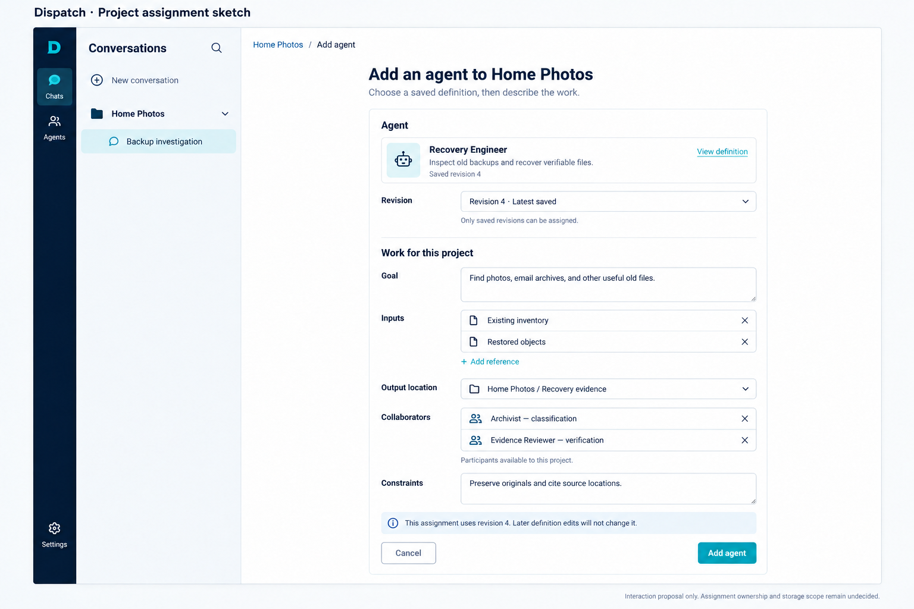
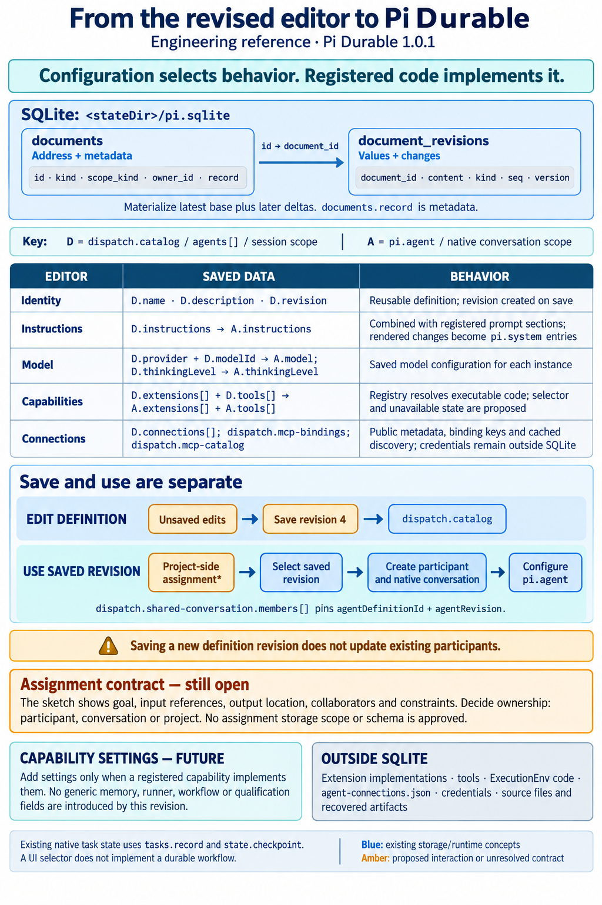

# Agent definition design — revised concepts

October 6, 2026. Chris requested new ImageGen images using Claude's independent review of the [original proposal](agent-definition-design.md). These four images revise the design; they do not implement new controls or settle the assignment contract. The original images remain available for comparison.

Chris subsequently requested a clearer MCP management flow. The [full-length MCP access concept](agent-mcp-access-design.md) replaces the passive Connections summary below with Add connection, server and identity details, available tools, and an explicit new/existing-instance access choice. These earlier images remain as the preceding design iteration.

**Implementation update:** Chris approved the editor and MCP screens on October 6. [WP-030](handoff.md#wp-030--agent-editor-and-connection-authorization) implements that scope using existing provider identities; the separate project assignment sketch remains an open contract. The following text preserves the original proposal context.

## Desktop editor

Instructions take the largest part of the form. Identity stays compact, model settings collapse into a summary, capabilities use plain names, and connections remain read-only. The only primary action saves the next revision. Unsaved changes and the effect on existing participants are explicit. Project assignment has moved out of this editor; generic knowledge, execution, workflow, and qualification controls are absent.

The example Files and commands capability corresponds to existing registered coding behavior; its friendly selector and the unavailable capability presentation are proposed controls. Archive inspection illustrates an unavailable option, not an installed extension. The example definition, revision numbers, and connection state are illustrative. The selected model and thinking level are concrete saved configuration, not a new claim of dynamic inheritance from workspace defaults.

## Phone editor

The same task uses one vertical column, with expandable model/capability summaries and a bottom save action. The connection summary leads only to read-only detail. This composition targets a 390 px phone layout; the generated raster is not a CSS viewport measurement. It does not establish touch-target sizes, keyboard behavior, focus order, scrolling, contrast, or responsiveness in implemented software. The shorter phone instruction text demonstrates wrapping and density, not a separate saved definition.

## Separate project assignment sketch

The project-side flow selects a saved definition revision, then collects this project's goal, separate input references, output location, collaborators, and constraints. It has one Add agent action and no definition-save action. References and collaborators are illustrative selections; their permissions, identity resolution, and persistence contracts are not implied by the picture. The depicted destination starts from project context but does not determine who owns the assignment data.

**Open decision:** assignment ownership may be per participant, conversation, or project. The interaction is a sketch; no `dispatch.assignment` schema or scope is approved. The sidebar and rail provide context and do not authorize a navigation redesign. In particular, current projects remain organizational metadata.

## Revised Pi Durable explainer

The explainer maps the five editor groups, includes public connection descriptors, separates saving a definition from using a saved revision, and leaves assignment storage explicitly open. The existing physical SQLite and native runtime details remain grounded in the [original source-backed reference](agent-definition-design.md#where-sqlite-stores-the-values), using Pi Durable 1.0.1. Capability-owned settings are a future design direction; this revision does not introduce generic `profile` fields, readiness checks, worker selection, or executable workflows.

## Review basis and remaining work

Claude inspected both original images and the technical reference after receiving the [review handoff](agent-definition-review-handoff.md). His main recommendations were to separate editing from assignment, explain revision pinning, make instructions dominant, reduce top-level runtime settings, expose capability availability, and design for a narrow screen. These images apply that guidance as a new proposal, not as an implementation package or a claim of Claude's approval of the revised images.

Before implementation, define save/discard and unsaved-navigation behavior, save errors and revision conflicts, unavailable-capability handling, accessible interactions, and the assignment contract. Any readiness results would need an exact saved revision and implemented checks; no dirty-draft Run check control is proposed here. Future capability settings should appear only when compatible registered code can interpret them.

All four final assets were generated with the built-in ImageGen tool and visually inspected for text, hierarchy, save/assignment separation, and storage accuracy. A targeted ImageGen edit made the assignment navigation consistent with the editor. The [prompt set](assets/agent-definition-v2-2026-10-06/prompts.json) preserves all generation prompts and that correction. Local links, prompt JSON, image files, and whitespace were checked. No software behavior changed and no tests or browser acceptance checks were run for these raster concepts.
