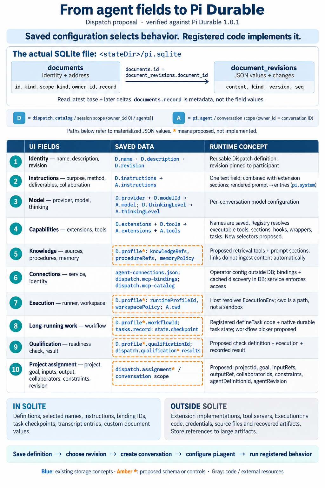

# Agent definition and project assignment — design proposal

October 6, 2026. Requested visual exploration, not an approved implementation package. The two images were generated with the built-in ImageGen tool and visually inspected. The existing implementation was checked at `98d2ad20553a51fb15465224cc7b820bac450473`, using installed `@earendil-works/pi-durable` **1.0.1**.

After Claude's independent review, Chris requested [revised concepts](agent-definition-design-v2.md): a simpler desktop/phone editor, a separate assignment sketch, and an updated mapping graphic. This original proposal and its source-backed storage detail are retained; the revised proposal leaves assignment ownership and storage scope explicitly open.

The design separates reusable expertise from a particular project's goal, inputs, collaborators, and output location. Saving a definition and adding its selected revision to a project are separate actions. The numbered groups in the editor match the technical graphic.

- [Pi Durable mapping](assets/agent-definition-2026-10-06/02-pi-durable-mapping.png)




## Status and interpretation

Current authoring saves name, description, instructions, provider/model, and thinking level. The runtime already stores extension/tool selections, configures each agent's native conversation, and supports operator-managed MCP connections. The additional controls, example recovery capabilities, managed-worker selection, qualification, and project assignment are proposals. Example names are illustrative; they do not establish that those capabilities, connections, or agents are installed. The surrounding mockup navigation is illustrative, not an approved navigation change.

`profile`, `dispatch.assignment`, and `dispatch.qualification` below are proposed application-owned schema names. They are not built-in Pi Durable concepts, and this work creates no database migrations or runtime behavior. Knowledge and workflow configuration needs implementing code; filling a field alone cannot add that behavior.

## Where SQLite stores the values

Dispatch opens **`<stateDir>/pi.sqlite`**, where `stateDir` resolves `DISPATCH_DATA_DIR`. Its default is `.local/state/dispatch`, relative to the service working directory. `auth.sqlite` holds authentication and `runtime-owner.sqlite` supplies the ownership lock; neither is the agent configuration store.

Pi Durable's physical schema separates a document's address from its value:

| Physical table / columns | Meaning |
| --- | --- |
| `documents.id` | Document ID used to join its revisions |
| `documents.kind`, `scope_kind`, `owner_id`, `family`, `key_value` | Indexed document address; a session document uses `owner_id = 0`, a conversation document uses its conversation ID |
| `documents.record` | JSON document metadata, including logical kind and scope; **not the configured field values** |
| `document_revisions.document_id` | References `documents.id` |
| `document_revisions.content` | JSON base value or a Chord delta operation batch |
| `document_revisions.kind`, `seq`, `version` | Base/delta discriminator, commit sequence, document schema version |

Read a value by taking the latest applicable base and applying later deltas in sequence. Use Pi's snapshot/document APIs for that reconstruction. A delta row is not itself a complete current configuration. `document_revisions.version` is a document schema version, distinct from an agent's application-level `revision`.

The physical indexed `documents.kind` column contains a JSON-encoded string. For a direct read-only address lookup, inspecting the logical kind in `record` avoids confusing it with a plain SQL string:

```sql
SELECT id, json_extract(record, '$.kind') AS kind, scope_kind, owner_id
FROM documents
WHERE retired_at IS NULL
  AND json_extract(record, '$.kind') IN (
    'dispatch.catalog', 'pi.agent',
    'dispatch.mcp-bindings', 'dispatch.mcp-catalog',
    'dispatch.shared-conversation'
  );
```

The paths below refer to **materialized document values**, not SQL columns. There is no native `agents` SQL table.

## Field-by-field mapping

**D** means one `agents[]` object in the session-scoped **`dispatch.catalog`** document, selected by agent ID and revision. **A** means the value of the conversation-scoped **`pi.agent`** document for one agent instance. Dispatch appends definition revisions to the catalog and records the selected definition ID and revision on a participant in **`dispatch.shared-conversation.members[]`**.

| UI group | Saved values and behavior |
| --- | --- |
| **1. Identity** | Name → `D.name`; description → `D.description`; displayed revision → `D.revision`. Revision is assigned by saving, not typed by the user. These are Dispatch definition metadata, not new fields on `pi.agent`. |
| **2. Instructions** | Purpose, method, deliverable standard, and collaboration rules are paragraphs within one `D.instructions` string, copied to `A.instructions`. Pi renders extension sections and appends the instructions section. Changes to the rendered system prompt are persisted as `pi.system` transcript entries in `entries.record`. The prose expresses behavior; it does not enforce access rights or constitute executable workflow code. |
| **3. Model** | `D.provider` and `D.modelId` become `A.model.provider` and `A.model.modelId`; `D.thinkingLevel` becomes `A.thinkingLevel`. These configure the native conversation's agent. |
| **4. Capabilities** | Existing `D.extensions[]` and `D.tools[]` selections become `A.extensions[]` and `A.tools[]`. Pi resolves registered names to executable definitions. An extension can supply tools, prompt sections, hooks, wrappers, and task definitions. The proposed UI selects installed capabilities; it does not generate an extension implementation. Dispatch also adds its collaboration capabilities and connection tools when configuring a participant. |
| **5. Knowledge and memory** | Proposed sources → `D.profile.knowledgeRefs[]`; procedures → `D.profile.procedureRefs[]`; memory policy → `D.profile.memoryPolicy`. An application extension would use these references through retrieval tools and/or prompt sections. Source documents remain in their owning systems. Persistent working state can use typed Pi documents; an external evidence ledger remains a separate store when selected. Pi does not automatically load a referenced guide or synchronize memory. |
| **6. Connections and identity** | The existing operator file `agent-connections.json` defines connection `id`, `agentId`, `name`, `endpoint`, `identity`, and transport setup; `DISPATCH_AGENT_CONNECTIONS_FILE` can override its location. `D.connections[]` stores public descriptors. Conversation-scoped **`dispatch.mcp-bindings.connections[]`** stores binding keys. Session-scoped **`dispatch.mcp-catalog.connections[key]`** stores discovered tool schemas, instructions, and discovery time. Executable MCP adapters are registered in code; the remote service and credential scope enforce access. Credentials are not agent-document fields. The example storage connection is illustrative. |
| **7. Execution** | Proposed runner → `D.profile.runtimeProfileId`; workspace choice → `D.profile.workspacePolicy`. The resolved directory path belongs in existing `A.cwd`. A host factory creates the `ExecutionEnv` implementation outside the database. Currently Dispatch uses `NodeExecutionEnv` for coding agents with per-conversation workspaces; a configurable managed-worker pool is not implemented. A directory path is not a security boundary. |
| **8. Long-running work** | Proposed workflow selection → `D.profile.workflowId`. Its implementation would register a versioned `defineTask` definition. Actual native task records use `tasks.record`, including `kind`, `version`, `input`, `state.status`, and live `state.checkpoint`; completed tasks have `state.outcome`. The indexed SQL status also lives in `tasks.status`. Resume logic and external-job reconciliation belong in the task/tool implementation, not in the selector or instructions. |
| **9. Qualification** | Proposed readiness-check selection → `D.profile.qualificationId`. Proposed **`dispatch.qualification`** documents would record results against the exact definition revision and check version. Their scope, retention, and result contract remain to be designed. “Run check” would invoke an implemented check; “Not run” is a result state, not an editable configuration field. No readiness check was run as part of this design task. |
| **10. Project assignment** | Proposed conversation-scoped **`dispatch.assignment`** value: Project → `projectId`; Goal → `goal`; Inputs → `inputRefs[]`; Output location → `outputRef`; Collaborators → `collaboratorIds[]`; Constraints → `constraints`; selected definition/revision → `agentDefinitionId` and `agentRevision`. The displayed project name would resolve through the existing project catalog. Current projects are organizational metadata, not this assignment contract. Prompt sections/tools would expose assignment data to the instance; collaborator IDs require participant resolution and permissions rather than automatically creating agents. |

## Boundaries that matter

Saving selected extension names stores configuration; the server's registry must still contain compatible executable code when it opens the session and resumes work. Native task/document schema versions and definition revisions solve different problems. Compatibility and migration behavior must be designed before changing running workflows.

SQLite can hold small structured evidence, references, task state, and transcripts. Source archives and recovered files should stay in their owning file/object store, with stable references and provenance recorded in documents or the selected ledger. A linked source, a transcript entry, a capability selection, and a recoverable task checkpoint are different things.

The instruction field's reusable output standard describes what good work looks like. The project assignment's output location identifies where this project's evidence should go. Likewise, reusable collaboration rules describe roles, while assignment collaborator IDs identify the actual participants.

## Evidence and checks

- Dispatch storage setup, catalog, save, and participant configuration: [runtime.ts](../server/runtime.ts).
- Connection descriptors, config, discovery, and bindings: [mcp.ts](../server/mcp.ts), [config.ts](../server/config.ts).
- Participant definition/revision pinning and collaboration setup: [shared.ts](../server/collaboration/shared.ts); public fields: [contracts.ts](../src/shared/contracts.ts).
- Pi Durable 1.0.1: locally inspected installed `dist/storage/sqlite/migrations.js`, `storage.js`, `dist/harness/agent.js`, prompt/entry implementation, and `dist/types.d.ts`. Upstream package: [Pi Durable](https://github.com/earendil-works/pi/tree/v1.0.1/packages/durable).

The original generated images (one now retired) were inspected for the ten matching groups, readable identifiers, and separation of current/proposed behavior. A spelling error in the editor's Sources label was corrected with ImageGen. Local documentation links, prompt JSON, PNG files, and whitespace were checked. No software behavior was changed; this is not browser, runtime, or responsive-layout acceptance evidence.
