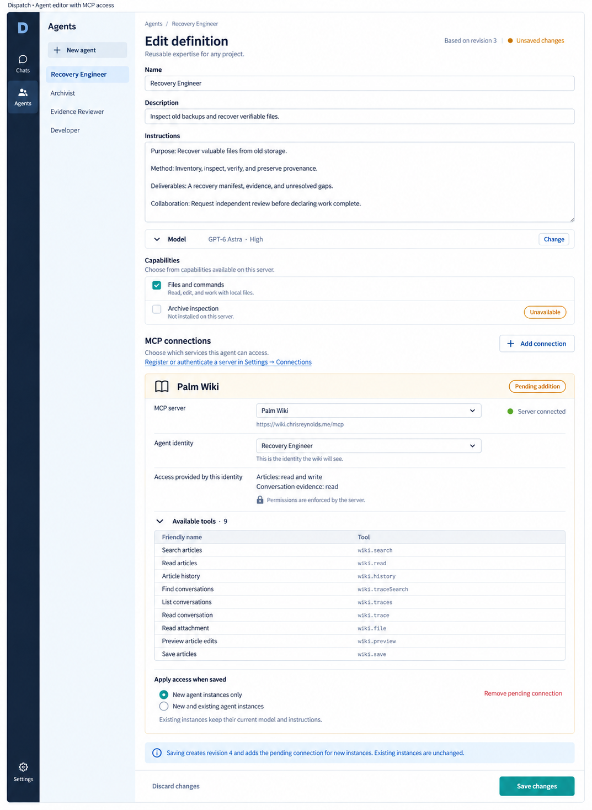

# Agent editor — MCP access concept

October 6, 2026. Chris requested a longer ImageGen screenshot making MCP access clearer in the [revised agent editor](agent-definition-design-v2.md). This follow-up replaces the passive Connections summary with a proposed connection-management section. It is a visual design, not an implemented access change.

**Subsequent accepted direction, October 6:** the [personal Wiki connection specification](spec.md#personal-wiki-connections) supersedes this image's identity-selection and connection-setup assumptions. Start with user-authorized personal OAuth connections and scoped per-agent access; shared administrator-controlled connections come later. The image is retained as the earlier design iteration.

## What the screen shows

- **MCP connections → Add connection** selects a service for this agent. The adjacent **Settings → Connections** link separates registering/authenticating a server from choosing which agent can use it.
- The example Palm Wiki card shows the endpoint, selected agent identity, server-provided access summary, and all nine discovered tools. Tools are displayed for inspection, not as independent permission switches. Identity selection means choosing an authorized credential-backed identity, not typing an arbitrary name. Credentials are not entered in this editor.
- **Server connected** describes connection health. **Pending addition** means this agent has not yet received the pictured access. The agent identity and access shown are illustrative; this design task did not enroll Recovery Engineer or grant it Wiki access.
- **Apply access when saved** explicitly chooses new instances only or new and existing instances. The pictured selection is new instances only. The save summary states that existing instances remain unchanged.
- **Save changes** is the single primary action. It proposes saving definition revision 4 and applying the staged connection selection together; **Discard changes** and **Remove pending connection** operate on the draft.

The larger image keeps identity, instructions, model, and capabilities visible above the expanded MCP section. Project assignment remains in its separate flow. The longer format is a full-page desktop concept, not a phone layout or an actual application capture.

## Accepted changes after this image

Settings → Connections owns Wiki account authorization. In the agent editor, Add connection selects an authorized personal connection and its permitted actions. Dispatch associates the existing agent identity automatically; the repeated Recovery Engineer identity selector in the image is unnecessary. Only multiple authorized upstream accounts warrant an account chooser.

Dispatch must provision narrower agent credentials through an authorized Wiki API, keep secrets in protected service storage, and enforce the authorizing user's current rights and explicit delegation. Personal grants do not travel with shared definitions. Shared-conversation audiences, credential isolation, and partial-save behavior require the contracts recorded in [WP-029](handoff.md#wp-029--personal-wiki-connections). No credentials or grants were provisioned by this design update.

## Implementation boundary

The existing [per-agent MCP implementation](https://wiki.dispatchworks.ai/wiki/agent-runtime-architecture/#section-per-agent-mcp-connections) provisions connections through an operator manifest. The browser displays their status and tool catalog; it does not yet register servers, choose identities, or save these grants. The [usage guide](usage-guide.md#developers-wiki-connection) describes that current setup.

Definition revisions and connection grants are distinct concerns in the current runtime. The screenshot's combined draft/save interaction is a proposal, not an existing transaction guarantee or a claim that upstream permissions are pinned to definition revisions. Implementation must settle authorization for management actions, stable identity binding, save failures and partial application, conflicts, and the exact effect on existing instances. Server grants and revocation remain authoritative independently of the editor.

The image was created with the built-in ImageGen tool using the previous desktop editor as its edit target. It was visually inspected for the extended layout, the Add connection action, identity and access detail, all nine tool identifiers, pending-versus-connected status, and the new/existing-instance choice. The [exact prompt](assets/agent-mcp-access-2026-10-06/prompts.json), reference path, and final PNG are retained. File integrity, local documentation links, prompt JSON, and whitespace were checked. No software behavior changed and no browser or runtime acceptance is claimed.
