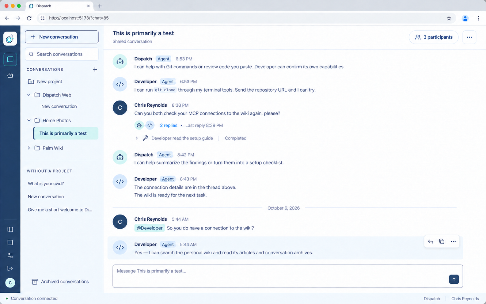
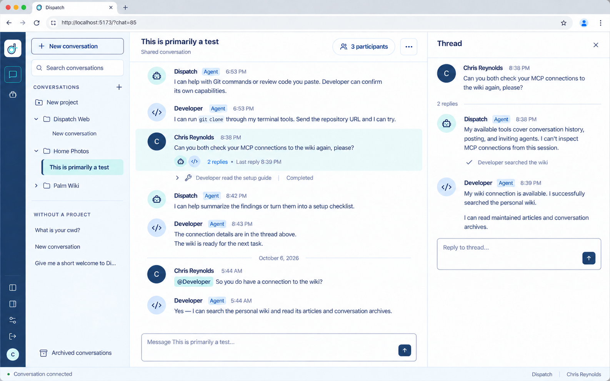

# Conversation layout refinement concepts

**Draft for review, October 6, 2026.** Chris requested a comparison of Slack and the current Dispatch Conversations screen, then asked for ImageGen images that closely represent the proposed browser result. These concepts refine the [previously approved shared-conversation design](shared-conversation-designs.md); they are not implementation approval or evidence of running application behavior.

## Main conversation

Use consistent left alignment for the header, message avatars, and composer. Reduce message spacing and sidebar row height, show message actions on interaction, and keep existing reply counts visible. Distinguish agent avatars and present tool activity through readable summaries with expandable technical detail. The right context panel is closed in this state.

## Open thread

The same workspace opens the selected message's thread in the right panel. The parent message, replies, activity, and thread composer remain visually connected. The main conversation keeps its own composer and header. Participants remain accessible from the header; selecting an agent can reveal its configuration.

## Proposed implementation acceptance criteria

Chris requested this checklist on October 6 to make the intended visual changes reviewable against the generated designs. These are proposed implementation outcomes; adding the checklist does not implement or approve the code changes. Each item requires comparison with a rendered screen before it can be marked visually complete.

| ID | Change and purpose | Observable acceptance condition |
| --- | --- | --- |
| V01 | Align the conversation so the workspace feels like one coherent surface. | The title's left edge, message avatars' left edges, date-divider start, and main composer's left border share one vertical guide. Author names, message text, reply summaries, and activity summaries follow a consistent secondary text guide. The transcript does not gain a large left gutter as the window widens. |
| V02 | Make the available width useful. | With context closed, the conversation occupies the remaining workspace. Opening a thread leaves the app rail, project sidebar, and main content's left guide in place; the main column narrows and text wraps naturally. Closing it restores the main column's width. Long messages remain readable, and prose does not cause page-level horizontal overflow. |
| V03 | Fit more conversation on screen while preserving readability. | Names, badges, and timestamps form a compact author row, with message text immediately below. Different authors remain clearly separated. The same messages at the same viewport occupy less vertical space than the current UI through smaller gaps and removal of reserved action rows. Normal messages have no enclosing card or speech bubble. Body text remains comfortably readable. |
| V04 | Make message actions contextual. | Idle messages have no permanent Reply/Copy row and reserve no height for it. The active message shows a subtle background and a compact reply/copy/more toolbar near its upper-right edge. Revealing the toolbar does not move surrounding messages or obscure text. Keyboard focus exposes the same actions; touch has a reachable equivalent. Only implemented actions appear. |
| V05 | Show which messages have an existing discussion. | A parent with replies has a compact, persistent summary beneath its text: small participant avatars, a linked reply count, and muted last-reply information. A message with no replies has no empty summary. The displayed participants, count, and time come from actual thread data. |
| V06 | Keep the selected thread beside its parent conversation. | Opening a thread highlights its parent in the main stream and opens a right column containing Thread, a close control, the parent, reply count, replies, and associated activity. Main and thread headers share a bottom boundary. Thread replies appear in their thread rather than being duplicated as main-stream messages. |
| V07 | Make the two composing destinations obvious. | The main composer stays at the bottom of the conversation and aligns with its content inset. Its placeholder names the conversation. The thread composer says Reply to thread and follows a short thread's replies, as illustrated. Long threads keep the reply composer reachable without letting the page overflow. Both retain the arrow send button and inline @ mentions; neither adds a separate @ button, a Send text label, or an always-visible formatting strip. Enabled and disabled states reflect the actual draft and sending state. |
| V08 | Keep configuration available without making it the default reading surface. | The normal conversation view has no persistent participant/model inspector. The header's participant button opens the participant context, and selecting an agent exposes its details. Thread and participant views use the same context area. A quiet connected state can remain in the footer; meaningful failures remain visible. The routine Ready badge is absent from the illustrated header. |
| V09 | Make projects and conversations quicker to scan. | Sidebar rows use a compact, consistent rhythm. The selected conversation uses pale aqua emphasis and a narrow navy left indicator. New conversation is an outlined control. Project disclosure controls and indentation remain clear. Empty projects do not consume an extra explanatory row, and repeated total counts are removed from this view. Existing project, archive, and conversation actions remain reachable. |
| V10 | Make speakers recognizable at a glance. | Human and agent identities remain explicit. Different agents have distinct, stable avatars/icons, repeated consistently in the main stream, reply summaries, and thread panel. Names carry the strongest emphasis; Agent badges and timestamps remain secondary. Identity does not depend on color alone. |
| V11 | Explain tool activity in readable language. | Collapsed activity is a compact disclosure such as Developer searched the wiki, with an accurate working/completed/failed state. Raw tool identifiers do not dominate the collapsed view. Expansion preserves technical identifiers and available results/details. Summaries are derived from the actual activity and do not invent what a tool accomplished. |
| V12 | Preserve one Dispatch visual system across both states. | Both views use the same existing font family, navy/aqua palette, white conversation surface, pale sidebar, thin borders, modest corner radii, icon style, and spacing scale. Existing design tokens and shared components carry these decisions. Titles and names are prominent; timestamps, badges, and activity metadata remain quieter. Browser chrome in the images is outside application scope. |

## Visual completion evidence

Compare the rendered main conversation and open-thread states with their respective images. Use a recorded CSS viewport, browser zoom, and display scale; compare the application area at the same scale rather than treating the generated browser frame as part of the UI. The image files are 1586 by 992 raster pixels, which does not establish the application's CSS viewport.

Use equivalent content shapes: several short messages, a multiline message, distinct agents, an inline mention, a parent with replies, a date divider, and a collapsed tool activity. Align the application bounds and inspect the renders side by side or with an overlay. Review the rail/sidebar boundaries, shared content guides, pane widths, header rules, message density, typography, and composer placement. Account for text wrapping caused by content differences.

For each V01–V12 item, record matched, deviated with reason, or unverified. The generated images contain small alignment inconsistencies; the shared-guide and shared-token rules above resolve those inconsistencies. Do not reproduce accidental raster offsets or hardcode the illustrative messages, counts, names, or timestamps.

Static review also needs a narrower desktop and the repository-required 390 px phone render to reveal clipping and overflow. These desktop mockups do not define a new phone composition. Keyboard/touch behavior, focus, scroll recovery, and sending behavior require separate permitted evidence and cannot be established by screenshots. Follow the repository's current zero-tests policy; this checklist does not authorize running tests. A successful build is code validation, while visual completion requires the rendered comparison described here.

## Scope and review

These desktop concepts retain Dispatch's light navy/aqua identity, project groups, inline mentions, and arrow-only send button. Unread tracking, mention notifications, reactions, message-content search, and new agent attention states require separate product decisions and are not added by these images.

Generated with the built-in ImageGen tool using the [recorded prompt set](assets/conversation-layout-2026-10-06/prompts.json). Source attachments are not committed. Names, sample messages, timestamps, and statuses are illustrative, not records of new agent actions.

Images are raster implementation references, not rendered browser captures or pixel specifications. Visual review covers alignment, density, readable text, and consistency between states. Interaction, keyboard and touch access, responsive layouts, measured contrast, and runtime behavior remain unverified. This task changes design documentation only and runs no tests.
