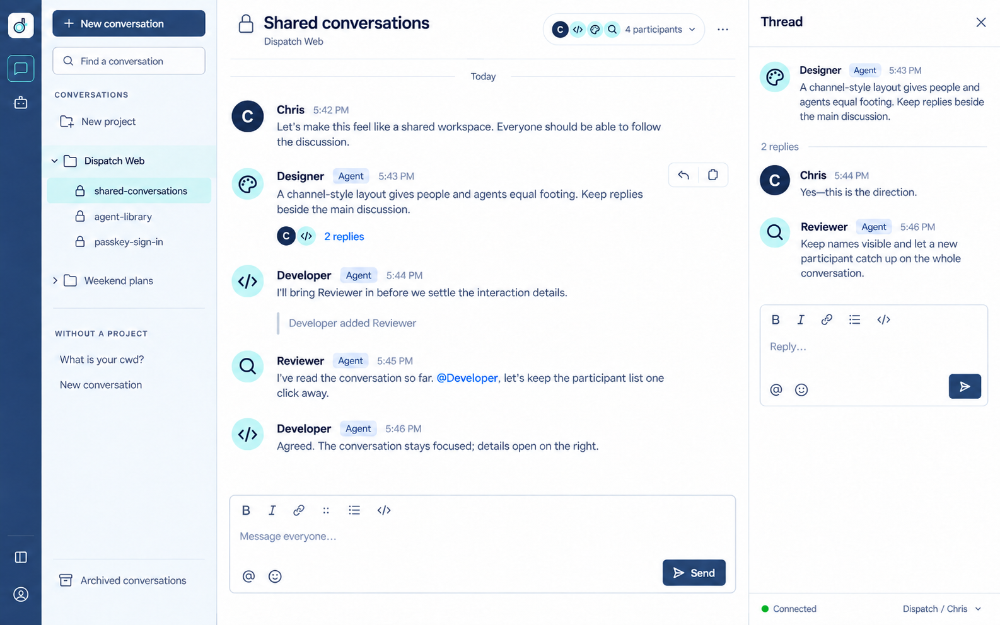
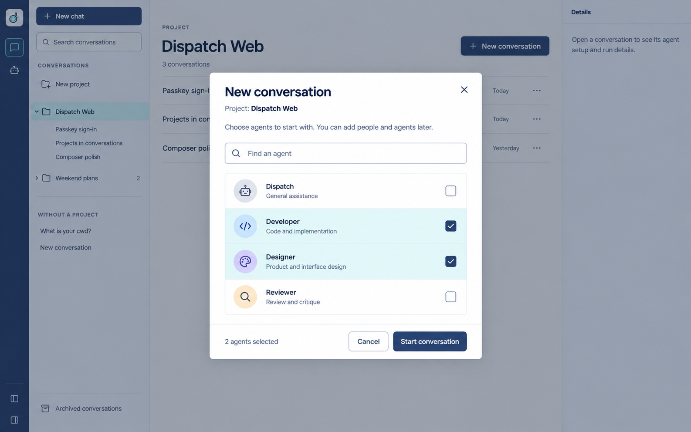
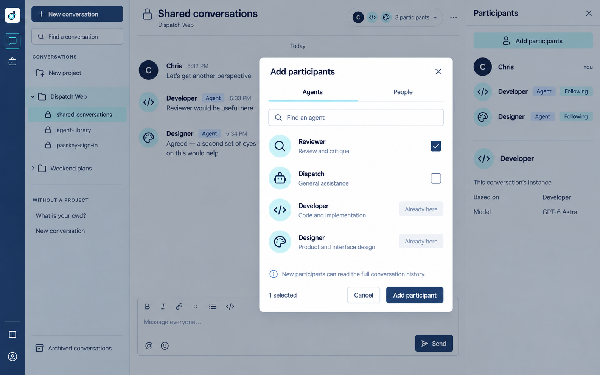
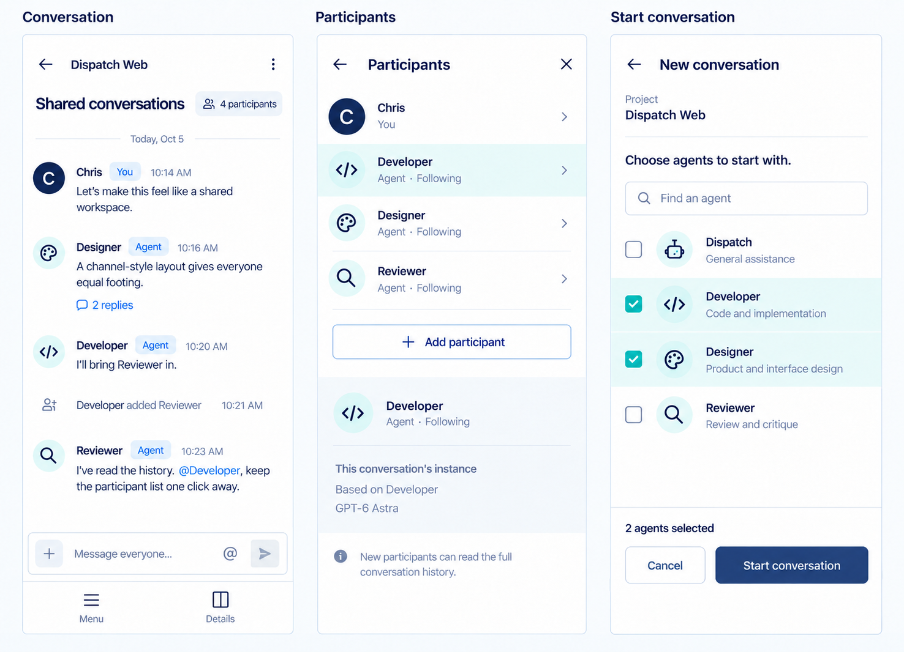

# Shared-conversation design concepts

**Proposed October 5, 2026; not implemented.** Chris requested ImageGen concepts for the accepted [shared-conversation behavior](spec.md#shared-conversations), then supplied a Slack screenshot as a better visual model. These designs explore that structure using Dispatch's light theme, navy/aqua palette and existing project navigation. They replace the earlier bubble-based concept for this design exploration; the running application's UI is unchanged.

The sample messages and agent definitions are illustrative. The concepts do not establish that Designer or Reviewer is registered, that an invitation occurred, or that a displayed status is live.

## Conversation and replies

Humans and agents share one left-aligned message flow with avatars, author names, timestamps and compact spacing. Agent badges and distinct icons preserve identity. A membership button in the conversation header opens participants; an inline reply count opens the related discussion in the right column. Project groups remain in the sidebar.

The reply-thread panel is a design proposal prompted by the Slack reference. Thread delivery, activation and its relationship to conversation-wide message consideration are not yet an accepted runtime contract. The mockup does not add calls, reactions, canvases or Slack's other features to scope. Showing one open conversation explains the absence of the existing multi-tab strip; this concept does not remove support for open conversation tabs.

## Choose starting agents

New conversation presents available agent definitions before creating any instances. The current project remains visible, selected rows have checkmarks, and Start conversation makes the creation action explicit. People and more agents can be invited later. No additional required name or model field is introduced.

## Participants and invitations

Participants occupy the same contextual column used by a thread. A human-facing invitation dialog separates Agents and People, identifies current members, and explains that newcomers can read the full history. The selected participant's details distinguish its reusable definition from this conversation's instance. Agent-initiated invitations appear as attributed events in the shared message history.

The disabled Already here rows illustrate inviting a missing role. They do not establish a new product restriction on how many instances of a definition may exist.

## Phone layouts

The conversation remains a single readable message column. Participants and creation use separate mobile surfaces with persistent actions. The design retains the existing Menu and Details entry points instead of shrinking desktop columns onto a phone.

## Generation and review

Generated with the built-in ImageGen tool. The [prompt set](assets/shared-conversations/prompts.json) records the final concepts and focused refinements. The user's Slack screenshot was a visual reference only; its conversation content and original attachment are not stored here. The earlier [approved project design](assets/projects-desktop.png) supplied Dispatch's visual language.

The generated still images were visually reviewed for layout, authorship, copy and consistency. They are raster proposals, not rendered application screens: keyboard/touch behavior, accessibility, measured contrast, responsiveness and runtime behavior are unverified. No application code, runtime data, deployment or test policy changed, and no tests were added or run.
