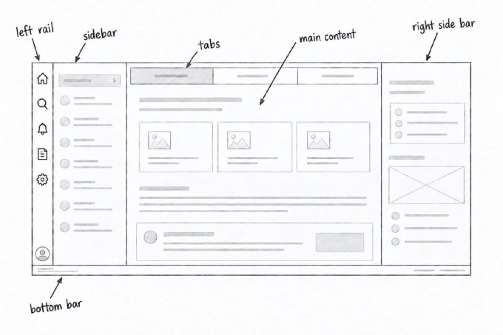

# Dispatch Web specification

**Status: current local application contracts, with explicitly separated future designs.** The implementation includes company authentication, shared conversations and threads, named agent definitions, local coding tools, generic MCP connections, explicit skills, shared projects with membership/default agents, message attachments, opt-in image generation and agent-prepared attachments, and opt-in PostgreSQL Pi storage. The branded workspace targets desktop and mobile browsers. Distributed workers, remote sandboxes, personal Wiki delegation, permissioned agent management, schedules and broader application RBAC remain future work. Implementation does not establish functional qualification; evidence and outstanding checks belong in [handoff.md](handoff.md).

## Reading this specification

- Unqualified requirements describe the current product contract, including failure, access and recovery outcomes. They are acceptance targets, not claims that every outcome has been verified.
- Sections labeled **Historical** or **Legacy** apply only to the stated compatibility scope. They are not alternative requirements for new workflows.
- Sections labeled **not implemented**, **Proposed**, **unresolved** or **deferred** are not current-feature acceptance targets. Their implementation requires an agreed work package.
- Use the current contract when deriving future tests; use [handoff.md](handoff.md) for dated verification evidence and remaining gaps. A discrepancy between source and an accepted requirement is a defect or unresolved decision, not permission to redefine the requirement to match the code. The [testing policy](#testing-policy) still governs which checks may run now.

## Product context

Dispatch Web is a browser workspace for companies doing general-purpose client problem-solving with agents. It uses stock Pi Durable for durable execution and recovery. The maintained product account and previous decisions are linked from the [repository wiki home](https://wiki.chrisreynolds.me/wiki/dispatch-web-next/).

## Product terminology

**Accepted October 8, 2026:** use **chat** for the user-facing shared space, including navigation, actions, search, tooltips and accessibility labels (for example, **New chat** and **Search chats**). Use **Pi conversation** for the underlying durable transcript scope in technical documentation; one Dispatch chat coordinates shared history and individual agent-instance conversations. This is a presentation change, not an API, stored-identifier or historical-title migration. Older sections use conversation for the Dispatch chat unless explicitly discussing Pi.

## Language and development requirements

Accepted October 3, 2026:

- Use TypeScript throughout the application: browser UI, server integration, Pi Durable extensions, tools, and application workflows. Nix expressions and other declarative build configuration remain in their native formats.
- Support local development, including on M1 Air (Apple Silicon macOS). Developers must be able to edit, run, debug, and test the application locally without deploying to a shared server. Runtime integrations may still need network access and credentials.
- Use Nix for builds and a repository-defined development environment. Pin Nix inputs and JavaScript dependencies in committed lockfiles, and share toolchain/dependency definitions between development and build outputs.
- Produce build artifacts from declared inputs without relying on globally installed Node tooling, developer-specific paths, production credentials, or live application services. Fetch dependencies through declared, pinned inputs; build steps must not download changing dependencies.
- Keep development state and runtime secrets outside build outputs and the Nix store. Build artifacts must remain separate from writable Pi Durable runtime state.

The entry points are `nix develop` for the local toolchain, `nix build` for application artifacts, and `nix flake check` for declared checks. Keep the local edit/run loop inside the development environment; a full Nix build should not be required for every source edit. Future automation must reuse the same build definitions.

Use [Mitchell Hashimoto's shared development/build approach](https://mitchellh.com/writing/nix-with-dockerfiles) and [Pi's Nix flake](https://github.com/earendil-works/pi/blob/b60993bcc299c705731f0281e2b4d0db7c72188b/flake.nix) and [package recipe](https://github.com/earendil-works/pi/blob/b60993bcc299c705731f0281e2b4d0db7c72188b/nix/package.nix) as references. Pi's inspected flake packages its coding agent; it is not a ready-made Dispatch Web development environment.

The local tooling package uses Node 24 from locked nixpkgs, npm workspaces with a committed dependency lock, React Router framework mode (`ssr: false`), React, Vite, and Tailwind. The build includes static HTML/CSS/JavaScript and a persistent Node service, with launchers under `result/bin/`. Base UI provides shared interaction primitives; Dispatch tokens and approved assets define the visual identity. Nix builds do not require NixOS or Docker. Apple Silicon macOS has build evidence. Dated x86-64 Linux artifact/startup and isolated Palm trial evidence is recorded in [WP-041](handoff.md#wp-041--generic-aws-container-deployment) and [WP-043](handoff.md#wp-043--isolated-palm-postgresql-trial); it does not qualify every revision, ARM64 Linux, all application behavior or AWS.

### Local development and later internal deployment

Accepted October 3, 2026: prioritize a quick localhost edit/run loop now. The frontend binds only to `localhost:5173` and proxies `/api` to the persistent loopback service on port 3001. Source edits hot reload without restarting Pi. Authentication protects user data and operations. Root `npm start` and `npm run preview` serve the built app at the same localhost URL and use the same local state directory; stop the development process first.

October 7 development update: frontend-only edits continue to avoid Pi restarts. The development launcher now watches the backend entry point and its imported modules, including runtime shared contracts. A matching edit gracefully stops the old backend before starting a replacement against the same state, while Vite remains running. Stock Pi remains responsible for native recovery; uninterrupted model/tool execution across a restart is not promised. A detached local launch may outlive the terminal; login/reboot supervision is outside this change. Launcher configuration and dependency installation still require an explicit stop/start.

**Local deployment boundary, October 7:** preserve native Web Next and its state. Palm owns host prerequisites and DNS/TLS routing; the local module keeps native deployment as its default and offers opt-in OCI deployment with a separate service identity and state. The pilot-only OCI cutover and upgrade are recorded in [WP-041](handoff.md#wp-041--generic-aws-container-deployment); they do not qualify AWS or full application recovery. Future cutovers require a stopped-owner backup and explicit scope; never merge installation state implicitly. The AWS module is not a local Docker deployer. Loopback HTTP remains the development endpoint, not an internal hosted site.

### AWS container deployment target

**Accepted target, October 7, 2026; not implemented or AWS-qualified.** Separate the Dispatch backend (authentication, authorization, company catalog, project/conversation directory, request routing and streamed results) from conversation workers. Each active conversation gets an ECS Fargate worker embedding Pi Durable and Dispatch's room/agent behavior. All collaborating agents in that conversation run within its owning Pi runtime, not separate role-specific containers. Historical conversations need durable state, not permanently running tasks.

Use RDS PostgreSQL for durable conversation history, private agent context, tasks, checkpoints and recorded tool calls/results, including available edit diffs. Each conversation has a logically separate Pi store: sharing one physical database must not broaden task scans or recovery across stores. Pi Durable 1.0.4 has no PostgreSQL backend; implement through its public asynchronous `Storage` interface, preserving Pi's execution/recovery ownership. Dispatch authentication and connection persistence also need supported integration; this is not a database configuration switch.

| Information | Authoritative home |
| --- | --- |
| Conversation/task state and durable tool history | RDS PostgreSQL |
| Curated notes and long-term knowledge | Wiki through authorized MCP access |
| Project source and versioned documents | A remote Git repository per project |
| Large files and artifacts | Ordinary S3 |
| Checkouts, dependencies, build output and temporary files | Disposable worker-local disk |

EFS and S3 Files are not required by this target. Wiki notes do not replace private Pi context. Multiple conversations working on one project can use separate branches and normal review/merge workflows.

**Workspace recovery policy:** guide agents to commit and push useful progress frequently. After replacement, make the fresh-workspace condition explicit; agents inspect the remote branch and durable tool history, reconstruct missing work, verify it and continue. A local commit is not remotely durable until pushed. Recorded edit/write calls may support reconstruction, but tool history is not a complete filesystem journal: arbitrary shell commands can change files without recorded diffs. Accept occasional agent-assisted reconstruction, not guaranteed filesystem restoration. Do not add automatic snapshots, continuous workspace synchronization or forced commit/push cycles preemptively; let observed recovery frequency, time and token cost drive additional machinery.

Keep one active executor per conversation's logical store. Replacement must not overlap an executor that can still act; database transactions alone do not ensure scheduler ownership. The ownership mechanism remains to be selected, and exclusive ownership does not promise exactly-once external effects. Preserve existing company/user authorization, membership, definitions, skills, connection revocation and “apply to existing conversations” behavior; distribution and cross-store update guarantees require explicit design, not silent removal. Routing/lifecycle, catalog distribution, scoped credential delivery and PostgreSQL integration remain implementation work.

Retain the ARM64 AWS target and a multi-platform OCI index with separately built, inspected and qualified `linux/arm64` and `linux/amd64` images. Preserve native host packages, local development and current LAN deployments. Generic infrastructure must remain independent of installation accounts, domains, credentials, state backends and private repositories; caller roots supply settings and immutable module/image pins. Review actual plan and cost and obtain explicit authorization before any AWS apply or storage migration.

The earlier single-service SQLite + S3 Files module is a prepared, source-reviewed candidate, **not this worker/Postgres topology**. Its [runbook](aws-deployment.md) and [SQLite qualification procedure](aws-sqlite-qualification.md) remain applicable only to that candidate and existing storage-specific evidence. See [WP-041](handoff.md#wp-041--generic-aws-container-deployment) for implementation history and outstanding evidence. Before real-data use, qualify the selected storage, ownership, interrupted-work recovery, authorization and backup/restore through an explicitly scoped work package. Prior Palm results, local image checks and source publication do not qualify the new target.

### Single-server container rehearsal

**Implementation, isolated Omarchy deployment and focused testing authorized October 7, 2026; integrated application topology not yet deployed or qualified.** Provide a new generic Terraform module for an isolated single-Linux-server rehearsal of the AWS application boundaries above, preserving the native installations and the PostgreSQL trial. The proposed implementation uses Docker Engine and Compose for stable web/API, PostgreSQL and worker-launcher services; the launcher manages per-conversation worker containers at runtime, not through a Terraform apply per conversation. This is not an ECS infrastructure emulator or a replacement for ARM64/AWS qualification.

Caller roots supply the host, instance identity, immutable image pins and restricted secret-file references. Palm owns host prerequisites and DNS/HTTPS integration. Keep Docker privileges confined to the launcher, not conversation workers. Preserve disposable worker workspaces and exclusive executor ownership; uncertain lifecycle outcomes require reconciliation, not permission to create another executor. The application split, lifecycle contract and acceptance criteria require a reviewed work package before implementation.

The generic [Terraform module](https://github.com/dispatchlabs-ai/terraform-local-dispatch-workers/tree/f08308ac45c55046e92ec9ee48abb7d0ebabb426) is published. Its [installer qualification evidence](https://github.com/dispatchlabs-ai/terraform-local-dispatch-workers/blob/f08308ac45c55046e92ec9ee48abb7d0ebabb426/docs/qualification.md) covers disposable synthetic Omarchy install/reapply/update-gate checks, not Dispatch execution or application drain correctness. Changed activation requires fresh authenticated confirmation of sealed admission, completed worker retirement and backend write quiescence; see the module's [drain contract](https://github.com/dispatchlabs-ai/terraform-local-dispatch-workers/blob/f08308ac45c55046e92ec9ee48abb7d0ebabb426/docs/drain-contract.md). Application commands/images and integrated qualification remain pending.

### Local PostgreSQL adapter slice

**Requested October 7, 2026; opt-in implementation with focused Palm trial evidence.** [WP-042](handoff.md#wp-042--local-postgresql-pi-storage-adapter) implements Pi Durable 1.0.4's public asynchronous `Storage` interface with PostgreSQL and an opt-in local setup using either a small container or Homebrew PostgreSQL. SQLite remains the default; use separate disposable development state rather than migrating existing installations.

The adapter must scope every record, lookup, scan, ID allocation and commit sequence to its logical store; commit each complete write batch atomically; and preserve fork ancestry, historical document reads and submission-request deduplication. Multi-query reads must observe a consistent state, and shutdown must drain admitted storage operations. `StorageRejected` is valid only when no batch effect committed. An uncertain COMMIT outcome remains an ordinary error so Pi poisons the Session and requires reopening; do not silently retry it.

This slice does not implement per-conversation workers, distributed executor ownership, authentication/connection migration or AWS deployment. Logical-store scoping is not company/user authorization or fencing of external tool effects. The [local setup](usage-guide.md#postgresql-development-wp-042) uses a dedicated PostgreSQL connection/advisory lock plus the existing local runtime-directory lock. Connection loss permanently fails storage; automatic takeover is unsupported because an old executor may still run tools. A non-secret endpoint/store marker prevents silently switching local state to another store or back to SQLite. Existing native/LAN state stays untouched. [WP-043](handoff.md#wp-043--isolated-palm-postgresql-trial) records focused controlled-restart, paired-restore and model-response evidence on disposable trial data; full storage conformance, crash and interrupted-agent/tool recovery remain unqualified.

## Testing policy

**Accepted October 3, 2026.** Do not add or run tests at the current stage. Make enough implementation progress to establish useful, stable behavior before investing in regression coverage. During this exploratory stage, use source review, TypeScript checks, and builds; record functional outcomes that remain unverified.

**October 7 scoped exception:** Chris requested first-deployment SQLite qualification for the AWS container target above. Focused deployment/storage checks with disposable data are authorized for that work; this does not authorize a broad application test suite or qualify the deployment by itself.

**October 7 Palm trial exception:** Chris accepted an isolated PostgreSQL trial and requested coordinated deployment with Deployer. [WP-043](handoff.md#wp-043--isolated-palm-postgresql-trial) authorizes focused disposable-data startup, persistence, restart recovery, duplicate-owner/isolation and paired PostgreSQL/local-state backup/restore checks. Existing installations remain untouched; this is not a broad test-suite exception, migration authorization or deployment qualification. Chris subsequently explicitly requested Developer use `agent-browser` after deployment; focused trial browser sign-in, chat/reload and desktop/phone review are included. See WP-043 for observed outcomes and remaining limits.

**October 7 single-server rehearsal exception:** Chris authorized implementing the container topology above, deploying it to Omarchy, testing it and correcting issues in the owning application/infrastructure/documentation sources. Focused disposable-data checks of the new deployment and its web/worker, authorization and recovery contracts are permitted, including browser review and coordinated failure/replacement checks. Preserve existing installations and the PostgreSQL trial. This does not authorize AWS deployment, existing-state migration or a broad unrelated regression suite; record the exact exercised cases and unresolved evidence in the implementation work package.

**October 7 evaluation-profile exception:** Chris approved one-time disposable local save/reopen, revision-history, conflict and archive checks, plus desktop/390 px browser demonstration for [WP-047](handoff.md#wp-047--agent-evaluation-profiles-and-editor). This authorizes neither deployment nor evaluation execution and leaves the general zero-tests policy unchanged. Observed outcomes and limits belong in WP-047.

When the workflows are ready to lock in, prioritize end-to-end tests and API tests that protect observable behavior and service contracts. These are the kinds of tests Chris wants in this codebase. Unit tests and tests that mirror implementation details are not the default; do not add them merely for coverage. Any exception needs a concrete benefit that the preferred test types cannot provide. Do not preemptively build a test framework or add test maintenance work while the product is still changing quickly.

Resume test work only after there is enough useful, stable behavior worth preserving; application regression tests remain deferred outside the scoped exceptions above. This policy supersedes earlier instructions in the handoff and contribution workflow to add tests with every implementation slice or run browser acceptance tests now. A successful type check or build does not establish that runtime behavior has been verified.

**October 6 focused exception:** Chris explicitly requested coordinator-led use of the local development site to validate the conversation layout refinement. Manual browser interaction and rendered desktop/phone comparison are authorized for [WP-028](handoff.md#wp-028--conversation-layout-refinement). This does not authorize adding or running automated tests or qualify unrelated runtime workflows. Record the specific observed outcomes and remaining limitations.

## Company access and authentication

**Accepted October 3, 2026.** Dispatch Web is a tool for companies. Access requires an authenticated user session with two-factor authentication (2FA). Support both time-based one-time passwords (TOTP) from authenticator apps and passkeys using WebAuthn/FIDO2.

### Use case: sign in to the company workspace

- **Actor and goal:** a company user signs in to use Dispatch Web.
- **Entry:** opening the application or a link to protected application content without a valid authenticated session presents the login flow.
- **Successful outcome:** after completing the required authentication, the user can access the application with the same initial capabilities as other users in their authorized scope.
- **Incomplete or failed authentication:** do not grant access to protected data, application operations, or live subscriptions. Enforce the authenticated session on the service as well as in the UI; completing only the first step of a two-step flow is insufficient.
- **Session end:** logout or expiry removes access through that session. Use the session policy below for API calls and existing subscriptions.

Support both methods, with at least one complete sign-in method enrolled. A password by itself never grants access.

### Login flow

Offer password plus TOTP, or a passkey with required device PIN/biometric user verification. The service verifies the WebAuthn user-verification result; touch or possession alone is insufficient. Use SimpleWebAuthn for WebAuthn and OTPAuth for TOTP, with opaque server-side sessions.

See [NIST's distinction between single-factor and multi-factor cryptographic authenticators](https://pages.nist.gov/800-63-4/sp800-63b/authenticators/) and [FIDO's passkey overview](https://fidoalliance.org/passkeys/). Passwords are scrypt hashes. TOTP secrets are encrypted with a private key stored separately from the authentication database. Passkey challenges expire and are single-use; TOTP counters are consumed atomically. Authentication endpoints apply persistent attempt limits.

### Equal access now; RBAC later

All authenticated users have the same baseline application capabilities and independent identities/sessions. Resource-specific authority still applies: shared projects distinguish managers from members, connection credentials have an owner, and conversation participation requires current access. These are current authorization requirements, not future RBAC. Broader application roles and role-management UI remain future work through the same server-side authorization boundary.

Each installation serves one company. Accounts have separate identities. Unbound conversation access uses explicit [shared-conversation membership](#shared-conversations); conversations in a shared project use [current project policy](#shared-project-access-and-default-agents). Agent definitions are shared within the company. Human-facing service operations receive their company/user scope from the authenticated session. The planned [agent-management operations](#permissioned-agent-management) instead resolve an agent principal from its trusted native instance binding; they must not borrow a human session or user identity. These boundaries do not grant cross-company access.

The accepted future [personal Wiki connection](#personal-wiki-connections) adds owner-bound resource authorization. Equal application capabilities and permission to edit a shared definition do not confer another user's external credentials or Wiki access. Shared team connections require a later, explicit administration policy.

### Enrollment, recovery, and sessions

An operator provisions an expiring, single-use invitation through the local CLI; there is no public registration or invented application administrator role. The invited user enrolls either a verified passkey or password plus TOTP. Passkey enrollment proceeds directly to the browser/password-manager ceremony without asking for a credential name. New enrollment requests omit the optional `passkeyName`; the service uses its existing `Passkey` label and still accepts labels from older clients. A restricted enrollment cookie cannot access chats, agent definitions, or live subscriptions.

Password/TOTP enrollment issues one-use recovery codes. Password plus a recovery code starts restricted re-enrollment and revokes existing sessions; it does not restore application access until a fresh factor is verified. An operator can issue a reset invitation after independently establishing account ownership, including for passkey-only accounts. Completing recovery replaces the old sign-in methods.

Sessions use 256-bit opaque tokens stored as hashes on the service. Cookies are HttpOnly, SameSite Strict, and Secure on HTTPS; only loopback development may use HTTP. Sessions expire after 12 hours absolute or 30 minutes without authenticated requests. Live stream heartbeats do not extend idle expiry. Logout and in-process revocations close subscriptions immediately; snapshots and periodic checks also enforce expiry and changes made by a separate operator process. Existing agent work continues when a session ends.

Account security supports additional/removable passkeys, password/TOTP enrollment or replacement, and session revocation. Factor changes require a sign-in completed within the previous ten minutes. The last complete sign-in method cannot be removed.

## Dispatch branding

**Accepted October 3, 2026.** Use Dispatch's established visual identity throughout the application: official logos and marks, the brand color palette, and typography and other styling defined by the brand materials. Apply it consistently to login, the workspace, chat, supporting views, and future features on desktop and mobile.

Reuse the approved source assets, preserving their proportions and intended background variants. Theme shared components through common design tokens so pages and controls follow the same identity. Responsive layouts may use an appropriate approved logo or mark variant. Keep text, controls, status, and focus indicators readable and distinguishable when applying the palette.

### Existing brand references

The [Dispatch design system's brand guide](https://github.com/dispatchlabs-ai/dispatch-design-system/blob/e4cacb0fbf656ac1ea55a6623cc9cf6b73047e1a/DESIGN.md) defines navy `#1D3D6A`, aqua `#4DD5CF`, ice `#F9FAFC`, slate `#333333`, and white `#FFFFFF`, with Inter for display, headings, and body text. The previous app records [asset provenance](https://github.com/dispatchlabs-ai/dispatch-web/blob/8ab0014bdd69c1585810cdb2099c5aa390843cd2/docs/asset-provenance.md) and [matching tokens](https://github.com/dispatchlabs-ai/dispatch-web/blob/8ab0014bdd69c1585810cdb2099c5aa390843cd2/apps/web/src/styles/dispatch-tokens.css), alongside its primary/inverse horizontal logos and icon mark. Use these traceable sources when integrating the brand; verify later brand changes before adopting them. Their older product workflows and layouts do not override this rebuild's accepted requirements. Font hosting remains an implementation choice.

The initial text-only startup page was provisional and is replaced by the branded application. Original SVG assets and their pinned provenance live in [src/assets](../src/assets/README.md); Inter is served locally from the locked font package. Shared CSS tokens carry the official palette. Do not invent replacement logos or treat component-library defaults as Dispatch branding.

## Desktop and mobile support

**Accepted October 3, 2026.** All user-facing functionality must be usable in desktop and mobile browsers, including authentication, navigation, main work, supporting views, and future features. Each implementation slice must support both from the start. Adapt presentation and interaction to the available space and input method while preserving the user's capabilities.

The desktop workspace uses the columns described below. On narrow screens, navigation, main content, and contextual supporting views may occupy separate surfaces rather than appearing simultaneously. Users must still be able to select main tabs and reach every defined supporting view and action. The supporting context always belongs to the active main tab, even when the main content and supporting view are not visible together.

Support touch as well as pointer and keyboard operation. Required actions must not depend solely on hover, a keyboard shortcut, or precise dragging. Keep controls reachable and content readable with the mobile keyboard open, in either orientation, and when text is enlarged. Avoid unintended page-wide horizontal scrolling; content that intrinsically needs more width may have an explicit local scrolling surface.

Changing viewport size, orientation, or visible workspace region must preserve the active work and unsent input. A responsive layout change must not itself submit, cancel, or restart work. The rule preventing stale supporting content or actions from appearing under a different main tab applies at every size.

The implementation uses navigation panels below 1100 pixels and a contextual panel below 800 pixels, with the main work remaining reachable. Buttons, icon buttons, inputs, dialogs, and tabs use Base UI primitives. Selects, checkboxes, radios, and textareas are native elements using shared token-based control styles. See the [October 3 UI/UX review and resolution](ui-ux-review.md). Modern desktop/mobile browsers with WebAuthn are the target; real-device, virtual-keyboard, and browser-matrix qualification is deferred under the testing policy. Native apps, installation, and offline operation have not been specified.

## Workspace layout

**Accepted October 3, 2026.** Use the supplied sketch as the basic desktop workspace layout, with the right side implemented as a full column that can have its own tabs. Adapt its regions for [desktop and mobile support](#desktop-and-mobile-support); simultaneous columns are the desktop arrangement. This layout decision is independent of the local tooling selection.

The sketch establishes the regions and their arrangement. Its sample icons, cards, text, and right-side widgets do not specify product features or final styling. The requirements below refine its right-side treatment.

| Region | Layout responsibility |
| --- | --- |
| Left rail | Narrow, far-left navigation rail. Its destinations are Chats, Agents, and Account. Selecting a destination switches the sidebar and main content; it does not add a main tab. |
| Sidebar | Navigation/list area beside the rail, distinct from the main content. Chats shows saved conversations without a repeated Dispatch logo; Agents shows its library; Account links to its settings. |
| Main content column | Primary workspace for the selected rail section, with a tab strip when multiple conversations are open in Chats and the active view's content below. |
| Right contextual column | Full column alongside the main tab strip and content, extending down to the bottom bar. It has its own content area and supports its own tabs. |
| Bottom bar | Horizontal bar beneath the workspace columns. It shows the current company/session and connection state. |

Rail sections own their sidebar and main content. Chat tabs belong only to Chats. Switching rail sections preserves the selected chat, open chat tabs, unsent drafts, and mounted agent/account forms. Returning to Chats restores its selected conversation. Agents' sidebar selects a saved agent. Choosing another agent or starting another editor asks before discarding a dirty draft; switching rail sections preserves it. Account's sidebar jumps to existing sign-in and session sections without unmounting forms. Rail selection remains in workspace memory and returns to Chats after a reload, except the explicit `?section=connections` return URL used by MCP connection authorization. These October 3 refinements supersede treating Agents and Account as main tabs.

The right column follows the active main content within the selected section. Leaving Chats clears its supporting content immediately; pages without a defined supporting view show an explicit empty state.

### Right column belongs to the active main tab

The active main tab determines the right column's context, available supporting tabs, and content. Right-column tabs are subordinate views for that main tab. Selecting a right-column tab changes the supporting view while leaving the main tab active.

When the user changes the active main tab, the right column must immediately follow the newly active context. Content, loading results, and actions belonging to the previous main tab must not appear as though they belong to the new one. Closing the active main tab similarly updates the right column for the resulting active tab, or clears its context if no main tab remains. A right-column action must target the main context it visibly serves.

Keep the right region as a full layout column rather than implementing the desktop design as a narrow inspector or overlay drawer. For conversations, the context area is closed by default and opens a thread or Participants, including saved instance configuration and observed activity. It must follow the active conversation and clear stale content when that context changes. The [current thread/participant layout](#threads-and-participant-presentation) supersedes the original always-open single-agent Details view. Other main tabs supply their own relevant context; do not add unrelated widgets to fill the space. This is consistent with the [earlier contextual-column and reserved-content decisions](https://wiki.chrisreynolds.me/wiki/dispatch-web/#section-decision-records).

### Use case: switch work and its supporting views

A signed-in user activates main tab A and sees its main content and any defined supporting views in the right column. Selecting another right-column tab keeps A active. Activating main tab B changes both the main content and the right column's supporting context to B. Late updates for A must not replace B's supporting content.

Keep desktop columns in their own layout space, with scrolling contained to their content. On smaller screens, panels expose navigation and supporting content. Preserve per-chat drafts and active work when changing layouts or main tabs. On desktop (above 1100 CSS pixels), both the conversations sidebar and contextual column can be hidden independently and resized with their inner-edge dividers. Controls in the left navigation rail remain available to reopen either column. Arrow keys resize a focused divider, Shift accelerates, and Home/End select the bounds. Width bounds preserve room for main content. Hiding or resizing preserves drafts, active work, and supporting selection. Width and visibility choices persist across main-tab changes and responsive layout changes during the open workspace; cross-reload persistence remains out of scope. Narrow layouts keep their navigation and Details panels.

### Message composer

**Accepted October 4, 2026:** the prompt field renders Markdown as editable content while typing or pasting; see the [composer decision](https://wiki.dispatchworks.ai/wiki/agent-runtime-architecture/#section-message-composer). Headings, ordered/unordered lists, quotes, emphasis, links, inline code, and fenced code use Lexical's Markdown transforms. Plain clipboard text is the import source; HTML is not interpreted as markup. Code-block paste remains literal. Markdown constructs without a transform remain text. Serialization may normalize Markdown spelling; this is a formatted editor, not a byte-preserving source editor.

Each mounted chat owns its editor and undo history; workspace drafts and submitted messages remain Markdown strings. External draft changes, including an acknowledged send, update the editor without reinitializing it on every keystroke. The existing request/retry and draft-version rules remain unchanged. Draft persistence across reloads is still out of scope. Copy/cut exports the selected content as Markdown.

The composer has one outer focus indicator, grows with its contents up to a scrolling bound, and has no privacy/status sentence in the toolbar. Send and Stop retain their existing state and accessible labels. Desktop Enter sends, Shift+Enter adds a line, and touch-primary Enter adds a line; IME composition must not submit. The existing 100,000-character limit applies to serialized Markdown: longer drafts remain editable, show an error, and cannot send until shortened.

### Message attachments

**Accepted October 6, 2026:** main and thread composers gain an extensible lower-left **+** menu, initially for files and images. Pasting an image adds an attachment rather than losing it to the Markdown text-paste handler. A top-left preview row shows small raster thumbnails or named file tiles, upload state, and removal controls. Text-only Markdown editing remains unchanged; drag-and-drop is outside this slice. [WP-040](handoff.md#wp-040--composer-files-and-images) owns implementation and qualification.

Attachments are separate from serialized Markdown. Limits are 10 MiB per file, 25 MiB total per message, and 10 attachments. Attachment-only messages are allowed. Upload failures remain visible and must not cause a partial send; acknowledged sends clear only the submitted draft version, preserving newer text and attachments. Main and individual thread drafts retain independent attachment references while switching open chats/layouts; reload persistence is not promised.

Successful uploads immediately become conversation assets readable by authorized conversation members, including before Send. **October 7 copy correction:** Chris requested completely removing the long sharing/retention sentences from the + menu and below the composer. Keep this boundary in the usage guide; removing UI prose does not change upload access or retention. Removing a draft preview removes its reference, **not** the stored asset; assets remain with the conversation to avoid cleanup races with durable recovery. Only the uploader may attach an asset to a new message in its owning conversation. Reuse across messages is allowed; duplicate references within a message are rejected.

The service authenticates and authorizes conversation access before parsing upload bodies. Storage uses generated IDs, not filenames; names are capped, sanitized display metadata. Stored MIME comes from server content inspection, not client declarations. Raster/text claims and known signatures (such as PDF/ZIP) reject incompatible declarations; unknown binary uses `application/octet-stream` and remains download-only. Text classification requires successful UTF-8 decoding; JSON/XML/code use a safe canonical text MIME and download disposition rather than their declared subtype. This does not promise full Office/container parsing. Only the upload route receives a larger body limit; other API routes retain the existing 256 KiB limit. Send requests carry bounded `attachmentIds`, never raw bytes, and idempotency includes attachment identity. Public snapshots carry attachment metadata. Reads recheck current conversation access and return `nosniff`; downloads are the default.

Only verified PNG/JPEG/GIF/WebP may render inline and enter native Pi image delivery/history. Model delivery/history/tool reads cap raw image bytes at 4 MiB per image and 8 MiB total per delivery/read, reporting omitted attachment IDs explicitly. Images exceeding the per-image cap remain previewable/downloadable; model use requires a smaller upload. Images omitted only for the total budget can be fetched individually through the scoped tool. These are application caps, not provider-acceptance guarantees. Validated UTF-8 files are readable through the scoped `conversation_attachment` tool with bounded, paginated reads and visible truncation. Other formats are download-only: accepting PDF, Office or binary files does not imply agent understanding. SVG is download-only `application/octet-stream`, never inline or model-readable text. Provider-side image encoding remains within native delivery, not browser message requests. Precise route/metadata details are maintained in the [usage guide](usage-guide.md#application-api).

### Inline mentions

**Accepted October 5, 2026:** Chris rejected the detached Mention dropdown and
requested Slack's inline mention interaction. In main messages and replies, typing
`@` opens a participant picker at the caret; typing a name filters it. The menu
shows people and agents already in the conversation with their avatars and names,
and distinguishes duplicate names.
**October 8, 2026 extension authorized:** the picker also offers available company
agent definitions not already participating, marked **Invite on send**. Selecting
one changes only the draft; sending invites that agent and mentions its resolved
participant identity in the same native Pi Durable commit as the public message
and delivery tasks. It remains an independent participant with access to the full
public history, including the inviting message. Existing instances are reused,
not recreated or reconfigured, even if their definition has since been archived.
Archival prevents new instances, not participation by existing ones. With multiple active siblings, definition mentions conflict rather than selecting arbitrarily; explicit participant mentions remain unambiguous. See [multiple instances](#multiple-instances-and-supplemental-instructions). Human invitations still use Participants; no
broadcast mentions such as `@everyone` are added. [WP-048](handoff.md#wp-048--invite-agents-through-inline-mentions)
owns implementation and local acceptance evidence.

Agent-definition invitation targets and participant IDs are distinct identities.
The server validates current company availability and participation authority,
resolves invitation targets alongside message validation, and persists only
resolved participant references in the public message. One stable request ID
covers invitation, message and delivery for retries. A failed submission must not
leave a newly invited agent behind without the message; removing its draft token
before sending must not invite it. Selecting or inviting an agent does not require
it to answer. Human message submissions and Participants invitations accept at most
50 agent-definition targets per request; this is a request limit, not a total
conversation-participant cap.

**Refined October 6, 2026:** remove the redundant toolbar `@` shortcut and restore
the compact arrow-only Send button in main messages and replies. The accessible
send/reply/retry labels and sending/retry icons remain. Typing `@` still opens the
inline picker. This supersedes the initial toolbar shortcut and visible Send text.

Arrow keys move through suggestions; Enter or Tab selects the highlighted person
without sending, and Escape closes the picker. Pointer/touch selection inserts the
same highlighted inline token. Shift+Enter still creates a paragraph, and IME
composition cannot select or send accidentally. An empty result stays explicit;
Enter does not send while that empty picker is open. Email addresses, links and
code do not trigger suggestions. The popup prefers the space above the caret and
fits the viewport, including a phone's visible viewport.

The selected identity is an atomic Lexical text node. Deleting its token removes
that mention; undo/redo restores it with its identity. Drafts remain Markdown,
using `[@Name](mention:<encoded participant ID>)` internally so identity survives
draft switching and copying between compatible conversation contexts. Importing a
reference to someone outside the current conversation yields ordinary text unless
it carries an agent-definition invitation identity. Such tokens remain intact
through catalog loading, archival changes and draft remounts so failed sends retain
their original invitation intent. Preservation is not authorization: the server
checks current availability on Send and may reject the target.
Draft invitation tokens use `[@Name](mention:agent-definition%3A<encoded definition ID>)`.
Submission separates current participant IDs in `mentions` from definition IDs in
`agentMentions`; both come only from remaining mention nodes. The server rewrites
accepted inline invitation-token URLs to participant IDs before public persistence;
inline/fenced code and escaped literal syntax remain unchanged. Public messages
render authorized references inline; older messages with detached mention metadata
retain their historical badges. Mention selection requests attention under the
existing participation policy and does not change authorship. Existing-participant
mentions do not change access; accepted invitation targets grant the agent access
on successful Send.

## UI implementation rules

**Accepted October 3, 2026, from the [UI/UX review](ui-ux-review.md), under Chris's authorization to update the rules.** These rules make the accepted branding, desktop/mobile, and workspace requirements checkable by source review and rendered screens. Items marked **Proposed** are new security or product decisions that still need Chris's confirmation.

### UI copy

**Accepted October 7, 2026:** no long explanatory sentences or paragraphs in routine UI. Use concise labels and actionable status/error text; put detailed explanations in documentation. Do not add prose that narrates obvious controls or implementation details. This applies to menus, toolbars, form hints and notices—not user-authored messages or document content. [Deslop review](../../../.pi/prompts/deslop.md) must check this rule before completing UI work.

### Tokens and readability

- Define reusable design values (colours, the type scale, the spacing scale, radii, shadows, and status colours) once as tokens in the shared stylesheet, and reference them from components. Derive tints and status colours from the [brand token reference](#existing-brand-references), and record any deliberate departure (for example, a darker status colour chosen for contrast) beside the token. One-off structural geometry, such as a column width or a breakpoint, does not need a token.
- Text meets WCAG 2.2 AA contrast: 4.5:1, or 3:1 for large text. This includes status, timestamps, hints, and placeholder-adjacent guidance. Focus indicators, selected-state indicators, status dots, and icon-only controls meet 3:1 against every surface they appear on.
- No text is smaller than the brand scale's smallest step (12 px). Express font sizes in `rem`, so that browser font-size settings as well as zoom enlarge text.
- Show selection, status, and errors with more than colour or font weight alone.

### Shared controls

- Every control of the same type looks and behaves the same everywhere, including size, mobile font size, focus treatment, and disabled and error states. Native semantic elements are fine. Style them through shared control styles or wrappers in `src/components/ui`, not per screen. Put a Base UI composition several features need there.
- Record one styling approach for components (Tailwind utilities with tokens, or token-based CSS) in [handoff.md](handoff.md) and use only that approach.

### Workspace keyboard, touch, and status

- The conversation search field matches the New chat button’s width, with its magnifying glass inside the input boundary beside the placeholder.
- Conversation rows have no leading chat icon. Reveal row actions on pointer hover or keyboard focus; keep them visible on touch layouts. The October 5 project design groups Move to project, Pin/Unpin, and Archive/Restore in one named actions menu, superseding the separate pin/archive icon buttons. Pinned conversations appear before other conversations, retain a visible pin, and sort by recent activity within each group. Save pin/archive choices as each human member’s personal conversation preferences. Archive hides a conversation from the regular list without deleting history, stopping work, or closing open tabs. An Archived conversations view supports reopening and restoring it. Older records default to unpinned and unarchived. Failed updates leave the prior state visible and show an error.

- Show the main tab strip only when more than one view is open. Each visible closable tab has its own close button inside the tab’s visual boundary; do not place a detached close button in the toolbar. When only one view is open, remove the entire main tab header, leaving no empty toolbar row. The tab header contains only tabs and overflow controls, never New chat. The sidebar’s New conversation opens the agent chooser, then creates and activates an additional chat tab while preserving other open work. Desktop column controls live in the left rail; narrow layouts expose Menu and Details in the bottom bar. Closing down to one view preserves its content and moves keyboard focus to the main workspace.
- Closing a main tab works from the keyboard without adding a Tab stop per tab, and tab-list semantics with close controls follow the WAI-ARIA Authoring Practices tabs pattern. When activating a tab mounts content or opens a subscription, focusing it must not activate it.
- The active main tab stays fully visible: scroll it into view when it is activated or the layout changes. When tabs overflow, show that more are available.
- Rail and navigation destinations, including those in the narrow-screen navigation panel, mark the current location visibly and with `aria-current`, not with toggle semantics.
- Every icon-only control has an accessible name. Do not rely on `title` tooltips to explain an action. On touch-primary layouts, primary actions and the entry point to supporting views show a visible label or another visible cue.
- Primary touch targets on narrow screens are at least 44×44 CSS px. No target is smaller than 24×24 CSS px.
- Connection and run status reflect what is actually observed. Never show "connected" for something that is not being observed. Show the active main tab's reconnecting or error state inside that tab's content as well as in the bottom bar.

### Preserving work

- "Unsent input" covers every form in a main tab, not just chat drafts: agent editing, account/security flows, and search. Switching main tabs or layouts never discards it. Closing a tab that has unsaved input asks before discarding it.
- Restoring a chat tab restores its transcript scroll position. Auto-scroll only when the reader was already at the latest content.
- **Proposed:** warn before idle session expiry. After re-authentication as the same user, restore that user's open tabs and unsent drafts. Clear them on explicit sign-out or when a different user signs in. Re-confirm identity for sign-in-method changes in place, without a full sign-out. Ask for confirmation before sign-out discards unsent input.

### Consistent collection screens

**Accepted October 3, 2026:** carry the conversation-screen refinements into Agents. Use the same shared sidebar spacing, primary action, search field, row styling, selection marker, hover/focus actions, touch target sizes, and bottom archive navigation. New agent occupies the same top-left sidebar position as New chat, with no duplicate main-header creation action or repeated logo. The agent search field matches the action width and uses the shared inset magnifying glass.

Agents initially selects the default definition. Selecting a sidebar row shows that agent's name, description, instructions, and supported actions in the main view rather than another catalog. A shared compact object header gives chat and agent views the same spacing, typography, and divider. Both supporting views use friendly catalog model names, falling back to the stored model identifier. Agents remains a rail section, with no main tab strip. Edit/archive actions appear at the row's right on hover/focus and stay visible on touch layouts. The default agent supports Edit but cannot be archived. Archived definitions offer neither action. An Archived agents view at the bottom allows inspection; restoring definitions remains unsupported by the existing service.

The right column, when opened, follows the selected agent's saved revision, model, provider, thinking, tools, and archive status. During editing it shows a live draft preview labeled Unsaved; the editor hides this optional column by default. Existing edits identify the saved revision and distinguish changed model/provider/thinking values as saved versus draft, with a summary of changed identity/instructions fields; a new draft clears previous details. The editor uses the saved default agent's model/thinking values for new definitions and retains existing save/conflict behavior. Creating or editing preserves unsaved input across rail and responsive layout changes. Sidebar selection, New agent, Edit, Archive, and Discard ask before abandoning a dirty draft; navigation is disabled only during a save. Search and archive-list state belong to the section and survive navigation-panel remounts. These refinements supersede WP-012's All agents catalog entry and empty Agents supporting view.

**Design refinement accepted October 3, 2026:** following the [Claude design review](agents-design-review.md), align the agent header and body to one left edge, use the description as lead text, and give instructions a distinct bordered reading surface. Start chat is the primary object action; on phones it fills the available row and a short model/thinking/tools summary remains visible outside Details. The default agent has a visible sidebar tag. Preserve the agreed rail/sidebar/main/right-column structure.

The current editor groups Identity, Instructions, Model, installed Capabilities, assigned Skills and MCP connections; see [agent editing](#agent-editor-and-existing-wiki-authorization), [Markdown instructions](#markdown-agent-instructions), [generic connection setup](#generic-mcp-connection-setup) and [skills](#explicit-per-agent-skills). Instructions has its guidance above the field. An action bar stays at the bottom of the main column, above mobile navigation, with Discard and Create agent/Save new revision; no duplicate Back action. The action bar aligns with the form measure. On phones, the editor omits redundant session status and the tools note while retaining Menu and Details; the Details drawer uses one contextual heading. Example placeholders are explicitly examples, shared selects use the same restrained chevron, and the right column shows the draft's current settings. The mobile navigation drawer anchors archive navigation and sign-out at its bottom. Column toggles are visually separated from rail destinations. These rules supersede the earlier requirement to disable agent selection throughout an edit.

### Actions and defaults

- Do not offer an action the service will reject for a known state. For example, show removal of the last complete sign-in method as unavailable, with the reason.
- Passkey signup must not require naming the credential. Let the browser/password manager handle creation and storage; credential management belongs in Account and security. This October 5 refinement supersedes the earlier enrollment-label requirement.
- New agent definitions start from the saved default agent's model and thinking level, not the first catalogue entry.

### Hierarchy and content

- **Accepted October 5:** use the approved Slack-style conversation design: humans and agents share compact, left-aligned message rows with aligned avatars, author names, timestamps and message actions. Distinguish agents with an Agent label and appropriate icon. This supersedes the October 3 right-aligned human-bubble rule. Preserve chronological order, native tool presentation and each message's actual author.

- Each main tab's `<h1>` names its destination or object, such as "Agents", "Account and security", or the conversation title. Taglines may appear only as secondary text.
- Label each agent's messages with its instance's saved name and retain that name after the definition is edited. The conversation header names the shared conversation and exposes its participants. Model/provider identifiers remain supporting participant details.
- Translate native Pi records into human-readable labels and statuses in the main transcript. Show raw JSON or enum values only behind an explicitly labelled technical-details disclosure, while keeping the native distinctions the [chat workflow](#first-agent-work-workflow-and-observable-outcomes) requires.
- Label native setup entries for what they are. Initial agent instructions are setup, not an "update". They don't interrupt the user/agent exchange when the supporting view already shows them.
- The right column has the same structure for every kind of main tab: a header row aligned with the main tab strip, then content. A main tab with no specified supporting view shows a brief empty state. Static help text is not a supporting view.

### Recording outcomes

- Under the [testing policy](#testing-policy), record UI properties that were not checked (contrast, device behaviour, keyboard flows) as unverified in [handoff.md](handoff.md). Do not describe them as implemented facts in the spec, README, or changelog.

## Conversation display titles

**Accepted October 6, 2026:** conversation actions offer Rename in Dispatch only. Any authenticated human member may change the shared display title; this is not a personal preference.

**Creation naming, accepted October 6, 2026:** the starting-agent chooser includes an optional conversation name, including project and agent-start entry points.

- Trim the name; a nonempty name is limited to 200 characters and becomes the shared display title. Blank or whitespace-only input keeps the existing unnamed-conversation behavior: “New chat” until the first message supplies a preview. The stored “New conversation” sentinel remains unchanged for retry matching.
- Explicit names, including the literal “New conversation”, are not replaced by the first message. Save the explicit display title atomically with creation while retaining the immutable creation title for retry comparisons. New records also retain whether the creation name was explicit, so an omitted name and literal “New conversation” are distinct retry inputs; legacy records keep their previous comparison behavior.
- Keep the name draft and selected agents on failure. An uncertain creation retry replays its original request, including title and project selection, rather than creating a second conversation with changed input. Successful creation or cancellation clears the chooser draft.

- `POST /api/chats/:id/title` accepts `{ title: string }`, trims surrounding whitespace, requires 1–200 characters, and returns `ChatSnapshot`. Apply the existing company/membership boundary; inaccessible conversations return 404.
- Persist a display-title override in the native catalog while retaining the immutable creation title for creation-retry comparisons. Older conversations retain their existing title fallback. An explicit “New conversation” override is a literal title, not a request to derive one from the first message.
- Rename updates conversation labels throughout Dispatch, including navigation, headers, project lists and search. It does not change IDs, messages, agent context/configuration, project membership, working directories or running work.
- Sidebar, archive and project actions open the same dialog with the current display title and Save/Cancel. Reject blank or oversized titles. A failed save retains the draft and saved title and displays an error; Cancel leaves the saved title unchanged.
- Functional and rendered UI qualification remain subject to the [testing policy](#testing-policy); record evidence and unresolved UI checks in [handoff.md](handoff.md).

## Projects in Conversations

**Current scope:** new projects created in the browser are shared projects governed by [shared project access and default agents](#shared-project-access-and-default-agents). Their members, manager settings and default agents are part of the product contract. Shared projects use the approved sidebar grouping and active-chat list: search includes project names and conversation titles, archived chats are excluded from active counts/lists, and opening a project preserves mounted chats/drafts while clearing stale conversation context. Shared-project chat creation requires participation; the setup flow preselects project defaults, while the project-row action below bypasses the chooser; operator read-only observers can inspect history but cannot create conversations or edit settings. Personal-group listing, creation and assignment are removed by the October 8 shared-only contract; historical records grant no additional chat access. Audience-changing moves into or out of shared projects are unsupported.

### Project-row chat creation

**Accepted October 8, 2026; implementation/qualification tracked in the handoff.** Add a compose action directly on each shared-project sidebar row, separate from its overflow menu. It creates a fresh chat in that specific project with the current project-default agents, activates its tab and focuses the composer in one action, without a chooser or naming dialog. Do not copy the active chat's history or participants; preserve existing tabs and drafts. Empty project defaults allow a people-only chat.

- Tooltip and accessible name: **New chat in [project name]**. The action is available on desktop hover/keyboard focus and remains visible on touch layouts. It must not toggle the project group or require opening the project view first.
- Apply current project participation checks; read-only observers cannot create chats. Missing or unavailable defaults must not silently create an unassigned chat or substitute a different team.
- Send `sharedProjectId` and omit `agentDefinitionIds` so defaults resolve atomically on the server; an explicit empty list instead requests a people-only chat. Preserve stored “New conversation” creation titles and retry identities while updating presentation wording. Reuse the existing creation and stable-request retry contract. Prevent duplicate activation while pending, expose failure without losing existing work, and preserve the original request on uncertain retry.
- The sidebar's **New chat** and project-view setup flow remain available for explicit agent/name selection. This decision does not add a tab-bar creation button, restore the single-view tab header, or introduce a separate temporary “Quick chat” type or keyboard shortcut.

### Legacy personal groups

**Superseded October 8, 2026:** Chris clarified that projects are shared-only and requested removal of obsolete personal-group code paths, not merely hiding their UI. The following is historical compatibility documentation, not authorization to retain personal-group creation or assignment behavior. Implementation and any stored-record/retry handling must be recorded in the handoff; removing feature support does not authorize automatic audience expansion or deletion of native chat history.

**Legacy contract, accepted October 5, 2026:** retain the approved [desktop design](assets/projects-desktop.png) locally. A project requires only a name. Many conversations may belong to one project; each conversation belongs to at most one project or remains unassigned. Additional project fields remain unspecified.

- Projects live inside Conversations, with a visible New project action and a name-only anchored form. Collapsible groups contain their conversations; unassigned chats appear under Without a project. Search matches project names and conversation titles. Archive navigation remains available at the bottom.
- Selecting a project opens its name and active conversation list in the main workspace. New conversation opens the starting-agent chooser and creates a chat in that project with the selected agents. For legacy personal groups, the sidebar's New conversation uses the active project, including the project of the active chat; otherwise it creates an unassigned chat. Starting from an agent or the welcome view remains unassigned. Existing chat tabs and drafts remain mounted when a project opens; Details clears to the empty conversation prompt.
- A conversation's actions offer Move to project, a single destination including Without a project, and the existing pin/archive/restore controls. Moving changes only membership. It never changes transcript, running work, agent configuration, or working directory. Archived chats keep membership and are still accessible from the archive view; counts and project lists include active chats only.
- Projects are private to their creator within their company, independently of shared conversation access. The service checks both project and conversation scope on every assignment. Project membership grants no additional access and does not inject other conversations into model context.
- Store project records and nullable chat membership in the existing native Pi session catalog. Existing records without project data remain unassigned; no second database, project Session, or execution engine is introduced. Creation and assignment use Pi atomic commits. Preserve the original creation project separately from mutable membership so retrying chat creation after a move still resolves to the same chat.
- Creation request IDs are stable across an uncertain retry and conflict on changed content. Names are trimmed, required, and at most 100 characters; stable IDs identify projects, so names need not be unique. Failed operations retain saved state and the form input. Concurrent membership changes use the existing serialized, last-committed preference update contract.
- Desktop uses the approved groups and project list; narrow screens expose the same controls through the existing navigation panel. Project-name drafts, search, archive selection, and group expansion survive responsive panel remounts. Legacy group name editing, deletion and sharing remain unsupported. Shared-project name/membership/default edits are specified separately below. Deletion, additional project fields, shared filesystem/context and automatic workflows remain outside the current scope.

## Shared conversations

**Product decisions and design accepted October 5, 2026; implemented locally, with functional qualification deferred.** A visible conversation is a shared discussion among human and agent participants, with one public history. Each agent participant has a separate native working conversation in the same Pi Session. The [maintained decision and source audit](https://wiki.dispatchworks.ai/wiki/agent-collaboration-spaces/) records the rationale and the limits of Pi's examples. [WP-024](handoff.md#wp-024--shared-conversations) owns the implementation package and qualification evidence.

Chris requested Slack as the conversation screen's visual model, approved the [ImageGen designs](shared-conversation-designs.md), and authorized implementation with subagents on October 5. The compact, consistently left-aligned message rows and contextual thread/participants panel supersede the earlier single-agent bubble presentation. The following thread contract carries the accepted shared-history and participation rules into the approved interaction.

### Accepted participant behavior

- Starting a conversation lets the human choose its starting agent participants from available company definitions, including when starting inside a project. Starting from an agent can preselect that definition. Keep the current project assignment and independent tab/draft behavior.
- All participants can read the public conversation and respond to one another. There is no mandatory coordinator or parent agent through which replies must pass. Public messages identify the actual human or agent instance; a definition name alone is not an identity.
- Every new public message from another participant, human or agent, causes each agent participant to consider whether to respond. Agents may stay silent. Mentions explicitly request attention; an agent's own message does not cause it to respond to itself. Remaining silent creates no public message and therefore no new reply cycle.
- Human members can invite humans and agents. Agent participants can invite existing company agents themselves; human invitations remain human actions. Unbound conversations are invite-only within the company; legacy personal grouping and shared definitions grant no access. In shared-project conversations, current project membership grants access and human invitations direct users to project membership management. Agent invitations still require participation.
- Developer and other named agents are reusable definitions with many independent instances. Each conversation has its own instances and working context; it does not inherit private working history from another conversation using the same definition. Copy the selected definition revision when creating an instance, preserving the existing immutable-configuration policy.
- A newly invited human or agent can read the entire public history, including messages from before joining. Model context limits do not delete history or silently turn this into a since-joining view. Private agent working state is distinct from the shared discussion.
- Legacy personal groups remain private organization: inviting someone to an unbound conversation does not share its creator's group or unrelated conversations. Shared-project membership instead grants full history and participation across that project, as specified in [project policy](#shared-project-access-and-default-agents).

### Listen before responding

**Accepted October 5, 2026:** agents listen while another participant is composing, then read the intervening public messages and decide whether a contribution is useful. The [maintained decision](https://wiki.dispatchworks.ai/wiki/agent-collaboration-spaces/#section-listen-before-responding) and [WP-026](handoff.md#wp-026--listen-before-responding) own this refinement to immediate independent activation.

- Coordinate one speaking turn across the visible conversation, including its reply threads. Humans always remain free to type and send. This is a conversation rule, not a global agent or tool concurrency cap.
- A mention gives a waiting public contribution priority. Otherwise ready contributions queue by acquisition order, not agent registration order; private work never reserves a place.
- Wait through native Pi tasks and keep claims in native documents. Recheck human presence and owner-task receipts on acquisition. Stop, cancellation, failures and restart must not leave an abandoned claim blocking other participants.
- Before each provider request, supply fresh attributed public history, including messages received while waiting or running tools. Coalesce already-considered queued deliveries without losing an admitted native submission on recovery. Full history and images remain available through `conversation_history`; bounded excerpts never replace that history.
- **October 7 correction:** model requests, analysis, tool decisions and execution proceed independently, without delivery-time or request-time speaking reservations. Only deliberate `conversation_post` calls and non-silent final answers acquire a speaking turn. Freshness is checked against the generating request's supplied history, and publication plus its stable receipt are atomic. **Later October 7 refinement:** save a stable contribution before waiting and retain its reservation through final review and publication. Unchanged history publishes without another review request. Only proven native final/post-tools successors inherit review ownership; unrelated generations never do. Release before further research/tools or provider retry. Human composing pauses the preserved candidate without generating another answer merely for typing; actual messages may require reconsideration. Ordinary tool-call prose and unadmitted final drafts/partials stay private; deliberate public progress uses `conversation_post`. Tool execution and status remain visible.
- If a human starts composing while an agent prepares its final answer, publication waits without discarding the draft. After the pause, only actual intervening messages require reconsideration. Superseded drafts remain private native history, excluded from public activity and Stop preservation. Native work is not forcibly interrupted for typing presence.
- Main and thread composers send authenticated presence without draft text. Each mounted composer has an independent sequence, so a delayed heartbeat cannot overwrite its newer pause. Client inactivity, blur, send, hidden tabs and unmount clear presence; a six-second service expiry also clears disconnected clients through a native task. A failed presence request must not disable sending.
- A successful final answer has one publication owner at its freshness-check boundary. Its public entry records the stable contribution identity atomically and is the publication receipt; native final-generation aliases retain activity/reference linkage across reviews; do not keep a second list of published replies. Delivery completion records status without publishing successful finals again. Existing duplicate publications are reconciled only when native generation identity and content match; retain raw entries, old message IDs, thread replies and saved-draft targets. Identical text from separate responses remains separate.
- Show Listening, Responding and Working as distinct agent states; show other humans' typing activity. Stop remains available while agents wait. Preserve the existing composer, draft, thread and member-access contracts.

### Threads and participant presentation

**October 6 layout refinement accepted:** the [conversation layout criteria and images](conversation-layout-refinements.md#implementation-acceptance-criteria) define the implementation target. Conversations default to a closed context area; opening a thread or participants uses that area without shifting the main content's left guide. Compact messages expose contextual actions and persistent data-backed reply summaries. Distinct participant identities, readable tool disclosures, and destination-specific composers retain the existing authorship, thread, mention, and draft contracts below. [WP-028](handoff.md#wp-028--conversation-layout-refinement) owns implementation and browser qualification.

**October 6 activity-author correction:** standalone agent activity uses the same avatar column, author typography, Agent badge and timestamp layout as public messages. Tool output and commentary sit in the author's content column; the author is never indented beneath another participant. This applies to specialized terminals/files and generic tool disclosures, including activity left visible after a failed response. Keep the existing terminal presentation and native/public record distinction. An exact bash-output repetition can use the compact output-reference/actions row only immediately after its own author's associated activity on the same date, without an intervening participant or attached image. Other messages retain their own identity. See [the correction evidence](handoff.md#activity-author-alignment-correction--october-6-2026).

- A reply stores the root public-message ID and remains part of the conversation's public history. It has the same membership and full-history access as the main discussion; there are no private thread members. Every other active agent member considers new replies with their thread context. An agent's response defaults to the triggering thread and may deliberately post to the main discussion.
- The main column shows top-level messages and reply counts. Opening a thread shows its root and ordered replies in the contextual column with an independent reply composer. The header's participant control switches that same column to members and saved instance details. A narrow screen presents these as a full-height supporting surface.
- Mentions reference participant IDs through the [inline picker](#inline-mentions). Selecting a participant inserts its readable name in the text and identifies that member in the submitted message; a mention requests attention without requiring an answer. Existing-participant mentions do not change access; available company-agent targets join on successful Send under the inline-mention contract. Plain text cannot impersonate a participant.
- Keep main and thread drafts, request identities and scroll state associated with their conversation/root. Navigation, responsive remounts and late acknowledgements must not discard or overwrite newer input. Closing a conversation with either draft asks before discarding it.
- New conversation lets the user select one or more active company agent definitions. The saved default can be initially selected; starting from an agent preselects that definition. In unbound conversations, human invitations choose existing active company accounts and grant access to that conversation only. Shared-project conversations direct human access changes to project membership management; membership grants access to every conversation in that project.

### Multiple instances and supplemental instructions

**Accepted October 8, 2026; implemented in candidate `a3a7fdf`, qualification tracked in [WP-050](handoff.md#wp-050--multiple-agent-instances-and-supplemental-instructions).** A participating human can explicitly add another instance of an available company definition in the same conversation. Each gets an immutable participant ID, separate native working conversation and saved base configuration. Optional instance name (100 characters) and supplemental instructions (50,000 characters) are set at creation; neither changes the definition or siblings. Store the supplement separately as `instanceInstructions`; `agent.instructions` remains the base snapshot. The native prompt includes both, persisted across restart. No live supplement editing is included. Adding an instance alone does not submit a model request; a later public message can activate it.

- Participants offers explicit Add instance; the inline picker lists active instances individually and an explicit add-another action. Ordinary mentions never silently create duplicates. Inspect base and instance instructions separately. Preserve conversation drafts on cancellation/error; closing a nonempty instance form asks before explicitly discarding its separate instance draft. Creation commits on confirming Add instance, independently of later Send; deleting the inserted mention does not remove the member. use the returned participant ID for insertion, not a snapshot-diff guess.
- Human-only `POST /api/chats/:id/instances` accepts `CreateAgentInstanceInput` `{ requestId, agentDefinitionId, name?, instructions? }` and returns `CreateAgentInstanceResult` `{ ...snapshot, createdParticipantId }`. Require current participation, company scope and an available definition; project read-all alone is insufficient. Stable identical retries return the original ID even after removal, never recreate it; changed requests conflict. New creation waits until any same-definition Removing instance completes cleanup.
- Ordinary invitations retain ensure-existing behavior, not duplicate creation. Ambiguous definition mentions return 409; choose an explicit participant ID instead. Agent invitation tools cannot create duplicates or reverse human removal. Per-instance removal leaves active siblings untouched.
- All active siblings consider new public messages. Independent context does not isolate files: configured workspaces remain shared unless worktrees/task assignments provide separation. Supplements guide behavior, not permissions or filesystem enforcement.

### Removing an agent from a conversation

**Accepted October 8, 2026; implementation/qualification tracked in [WP-049](handoff.md#wp-049--remove-conversation-agents).** An authorized human participant can remove an agent instance from Participants. Project read-all observers cannot remove agents without membership. This ends that instance's membership, not its definition or recorded history; human membership changes remain outside this operation.

- Persist `active → removing → removed` on the agent member; older records default to active. Atomically mark removing, fence new deliveries/publication and agent invitations, and schedule native durable cleanup. No global Stop fence is introduced; other participants continue working and humans can keep sending.
- Cleanup releases the member's speaking reservations and aborts/joins its queued delivery and contribution work before aborting its native agent conversation. Restart resumes cleanup through Pi. Failure retains the fence, exposes a retryable removal error, and never silently reactivates the instance.
- Preserve public messages, native tool history, saved configuration and original participant IDs for attribution. Show Removing/Removed rather than deleting the member or presenting it as actively listening. Unpublished contributions and prepared files are not released by removal. New mentions target only active participants; historical mention references remain attributable. A contribution prepared before its mentioned target was removed may retain that reference when published, without notifying the removed instance or cancelling the unrelated author.
- Only explicit human invitation, including an invitation through a definition mention, can add that definition again, as a fresh instance using its current available revision. Retain the removed instance as history, without reviving its queued work. Agents cannot undo a human removal by reinviting the definition.
- Removal is idempotent by immutable participant ID. Retrying cleanup must not cancel another instance, duplicate membership or affect unrelated work. Cancellation cannot undo completed file changes, external actions or charges.

Dispatch owns membership policy and fences; stock Pi Durable 1.0.4 owns task cancellation, execution and recovery. This is distinct from conversation-wide Stop, which allows later participation by the same members.

### Implementation approach and preservation

The following engineering approach implements the accepted behavior; exact schemas and native transaction boundaries must be confirmed against Pi's public API during WP-024.

- Store membership and instance/configuration references in Pi documents and public messages as native entries with stable message IDs, structured authorship, and optional reply/mention references. Keep each participant's native working conversation in the same existing Session. Introduce no competing transcript database, scheduler, or cross-store coordination layer.
- On public-message commit, persist the recipients and durable delivery work through native Pi tasks. Use stable message/recipient identities and ordered recipient progress for retries and recovery. Watches refresh presentation; they are not the only record that a message needs delivery. Agent outputs become public messages through the same author-checked path as human posts and can activate other members.
- Supply full public-history access through native records, with explicit context preparation and retrieval for histories larger than a model window. Preserve author roles when supplying context; another agent's post must not be represented as a new authenticated human instruction. Joining grants history access without creating a public reply for every historical message.
- Derive access from authenticated company scope plus current conversation membership for unbound rooms, or current shared-project policy for bound rooms, on list, read, write, invitation, Stop and subscription paths. Read-all project observers cannot participate, invite, rename or Stop unless they also have membership. Resolve agent-tool callers from their native instance binding, never from an author ID asserted in message text. An agent can invite only available company definitions into a conversation it already belongs to.
- Pinning and archiving remain personal organization of the shared chat; project binding and policy are not personal preferences. Personal grouping and move controls are removed under the October 8 shared-only contract.
- Preserve existing IDs, URLs, public messages, native configuration, working directories, ongoing work and saved project assignments. Existing chats initially retain their human creator and saved agent instance. Do not rewrite their native transcripts or silently cancel work to establish the new representation. Record the actual compatibility strategy before changing persisted behavior.
- Keep public message history available independently of native active-context compaction/reset boundaries. Preserve each agent's native tool activity and status with its author; do not flatten tool records into invented chat messages or expose private model reasoning. Never stream unadmitted assistant prose; show only admitted public messages alongside sanitized tool execution and status. Retain safe reset/compaction markers without private summary/handoff content. Define the projection and any historical limitations explicitly.

### Failure, control and recovery contracts

- A failed invitation or message leaves committed membership/history intact and retains the human's unsent input. An uncertain retry reuses its logical request ID; changed content with that identity conflicts. Duplicate delivery or reporter recovery must not create duplicate public messages or duplicate agent instances.
- Service restart reinstalls the required native definitions and resumes stored delivery and agent work through Pi. Browser disconnect stops observation only. Distinguish an agent that is working, silent, stopped, or failed; one participant's failure must not erase other participants' public history or work.
- Stop is conversation-wide for currently admitted responses and their pending deliveries, preserving admitted public history and committed tool output, without publishing unadmitted assistant drafts or partials. Persist the stopping boundary and stop/join native delivery work before cancelling agent runs, so queued work cannot immediately restart them. Reject new messages while this transition is incomplete and retain their drafts; a later new message can resume participation. Cancellation and recovery remain native Pi operations.
- Preserve the existing restriction to local development and trusted local coding access. No new concurrency cap, worker deployment, remote sandbox, autonomous human invitation, or cross-conversation private-memory sharing is implied.

## Web architecture

**Implemented direction, October 3, 2026.** The coordinated implementation adopts the earlier SPA/service recommendation and the following concrete contracts.

Use a React SPA with a persistent TypeScript/Node service hosting stock Pi Durable. The localhost frontend now uses React Router framework mode with `ssr: false`, using Vite. The earlier data-mode alternative was not used for this tooling package. Framework mode offers route types, route-module conventions, and code splitting; it does not provide the live agent-state contract. See [React Router's modes](https://reactrouter.com/start/modes) and [SPA behavior](https://reactrouter.com/how-to/spa).

The service serves the built SPA and API on one origin. During local development, run the frontend development server separately from the Pi runtime and proxy application requests to the service. Frontend hot reload must not create another runtime owner or cancel agent work. The web package owns both browser and service code. Local/LAN deployment evidence and the separate unimplemented AWS worker target are scoped under [deployment](#local-development-and-later-internal-deployment).

The recommendation favors consistent patterns for agents: typed and runtime-validated API contracts, a standard route-module pattern, one live-state subscription layer, and one shared set of UI primitives. Routing-level loading and one-shot commands should use documented patterns; ongoing Pi state should flow through the subscription layer. Client caches are derived views, not independent durable sources of truth.

Durable execution always has an appropriate persistent owner, independently of the browser rendering framework.

## First agent-work workflow and observable outcomes

**Accepted October 3, 2026.** Implement chat first, directly on stock Pi Durable, with one default agent configuration. Chat is the first usable feature in the broader agent workspace. It must meet the existing company-login, desktop/mobile, and workspace requirements.

### Use case: chat with the default agent

- **Actor and goal:** an authenticated company user works with the default agent through a conversation.
- **Entry:** the user starts a new conversation or reopens an existing conversation within their authorized scope.
- **Successful outcome:** the user sends messages, sees admitted public replies and live native tool/status activity, and continues the conversation with its saved history. Unadmitted answer prose is not streamed publicly.
- **Control:** the user can stop a response. The UI must distinguish a stopped or failed response from a completed answer; Stop cancels all currently admitted participant responses and pending deliveries under the [conversation-wide Stop contract](#failure-control-and-recovery-contracts), preserving admitted public messages and committed tool output, never publishing unadmitted drafts or answer partials.
- **Continuity:** history persists across reloads. Browser disconnection does not cancel admitted work; reconnection restores the current committed state. The service resumes native work when reopening its storage; functional recovery qualification is deferred under the testing policy.

The default agent uses Pi's normal per-conversation agent configuration. The original single-agent chat is now a shared public conversation with independent native agent working conversations; each instance retains its own configuration and ongoing work. Selecting the default configuration for multiple chats must not combine their conversation state. The initial agent has general-purpose instructions and no tools. On first startup for the company, explicit service configuration seeds its model/thinking level, otherwise existing Pi defaults apply. The default is persisted in the same company-scoped catalog as other definitions and is editable through the same editor, immutable revisions, and conflict checks. Later restarts and changes to service defaults do not overwrite it. The default ID remains `default`; it cannot be archived. Edits affect only new chats; existing chats retain their saved name, revision, and native configuration. This October 4 refinement supersedes the initial operator-managed default.

Keep Pi's transcript and execution distinctions intact through the integration, including tool activity and other native entry types. The initial UI can expose a small subset of capabilities, but its model must not flatten the underlying conversation into only user/assistant text or create a competing durable history. Tool capabilities selected for the first agent must have whatever interaction and controls their use requires.

### Bash terminal presentation

**Accepted October 4, 2026; presentation refined October 6:** use the compact terminal for `bash`, alongside the write/edit/read cards below. Group tool activity and consecutive assistant messages under the agent’s heading, above the first part of the response. Show the command and combined stdout/stderr together, open by default, with native live output replaced by the recorded result in the same component. Render output as plain text. Show observed preparing, waiting, running, completed, failed, stopped, interrupted, or unavailable-result status. Preserve native diagnostics, including exit errors and full-output paths, and keep raw call/result data in native storage without a debug disclosure in tool activity. This supersedes the initial debug-data option, removed at Chris’s request on October 4. An admitted public message containing only an exact repetition of bash output (plain text or one fenced code block, ignoring outer whitespace) may use the compact output-reference/actions row only immediately after its own author's associated activity on the same date, without an intervening participant or attached image. Do not hide its authorship or treat private assistant text as a public message; see [activity-author alignment](#threads-and-participant-presentation). Preserve added explanation, non-text content, interrupted/incomplete responses, and the original stored message; never suppress across a new user message or context boundary.

Pair native results with their nearest preceding unmatched call by call ID and tool name; preserve unmatched results. This is a snapshot projection, not a second execution or history store. Tools without a custom presenter use the generic fallback with status, output, and images. Keep native reset/compaction and other transcript entries. Long output scrolls within the terminal and follows new output only while the reader is already at its bottom; terminal disclosures must remain operable at desktop and phone sizes.

### Write and edit presentation

**Accepted October 4, 2026:** use Pierre Diffs for both `write` and `edit`, following the [presentation decision and library research](https://wiki.dispatchworks.ai/wiki/write-tool-presentation/). Each appears as an open, collapsible file card with its recorded path and native execution status. Use one unified column, line numbers, syntax highlighting, green additions and red removals with `+`/`−` indicators. Markdown files display source. Long content wraps within a bounded, focusable scrolling region.

- `write` presents all recorded `arguments.content` as additions, whether it created or overwrote a file; this is a display convention, not a before/after comparison. Show the written line count, including blank lines, or an explicit empty-file state. Before confirmed success, identify it as requested content and retain the observed status and any failure output.
- `edit` presents Pi's recorded `result.details.patch`, preserving actual file line numbers and the patch's surrounding context. Pending edits wait for that record; do not reconstruct a whole file from replacement snippets or read the current filesystem. If a patch is unavailable, retain the native result and any recorded display diff. Malformed or unrenderable previews fall back to recorded source without hiding the outcome or breaking the conversation.
- Build these cards from the same native entries on every load. Existing calls receive the current presentation without a migration or tool rerun. The shared-conversation projection reads persisted native history across reset/compaction boundaries while excluding private working input, reasoning and control-tool content.
- Lazy-load the pinned `@pierre/diffs` 1.5.1 viewer. Use a shared local worker pool for highlighting and a virtualized code region per open card, keeping data and assets on the application origin. Keep inputs and options stable across unrelated snapshots. Pi continues to own execution, result details and durable history; no runtime or storage change is required.

### Read presentation

**Accepted October 4, 2026:** show how many file lines a `read` returned and the lines themselves; see the [read presentation decision](https://wiki.dispatchworks.ai/wiki/read-tool-presentation/). Reuse the open, collapsible file card with the recorded path and native execution status. Show the returned line count and original file range above a neutral, syntax-highlighted source view with line numbers. Markdown remains source text. Long lines wrap within the same bounded, focusable region as write/edit cards.

- Derive content from the successful recorded result, excluding the harness diagnostic appendix. Start numbering at the call's `offset`, or one when omitted. Count returned lines rather than the requested maximum; preserve blank lines and use native truncation/continuation information to distinguish an excerpt's final blank line from a file's trailing newline.
- Keep continuation/truncation notices below the content, and label a partial line explicitly. Errors are native output and diagnostics, not file lines. A successful result with no text has an explicit empty-output state. If the original call is missing, show relative returned-line numbers and explain that original file numbering is unavailable.
- Reuse the lazy Pierre viewer and highlighting workers. An unchanged context hunk provides original line numbers without change colors or file loading. Rendering failures retain recorded source. Existing stored reads gain the current view on reload, within the existing active-history boundary; do not rerun reads or inspect today's file contents.

### Feature sequence and broader scope

After chat, add named agent definitions and the ability to start independent conversations from them. A reusable definition supplies configuration for new conversations; it is distinct from any one running conversation. The catalog, editor, versioning, and update policy are Dispatch features built on Pi's native configuration. Definitions are company-shared, versioned immutably, and copied into new conversations. Each conversation retains the name from its saved agent revision, including after later renaming or archiving. Editing or archiving a definition never changes an existing conversation. Stale edits return a conflict; archived definitions cannot be used for new chats or silently restored by editing.

Continue adding Pi Durable capabilities in focused feature slices: tools and integrations, delegation and handoffs, background work, event- and schedule-triggered work, and the broader native configuration surface. These remain product goals. Their order after named definitions and their detailed workflows are unresolved; the [capability assessment](https://wiki.chrisreynolds.me/wiki/pi-durable-capabilities/) records the native foundations and application responsibilities.

Design the first chat around Pi's public interfaces and the ownership boundaries below. Add later features' detailed behavior and UI when their use cases are agreed. The right column remains available for specified supporting views; chat-first scope does not invent content for it.

### Individual-agent evaluation

**Data direction accepted October 7, 2026; profile/editor implemented and focused local acceptance demonstrated October 8, 2026.** Start with individual agents, supporting both stored standalone prompts/cases and evaluation of real usage. Team evaluation is deferred. Product intent is recorded in the [evaluation decision record](https://wiki.chrisreynolds.me/wiki/dispatch-web-next-agent-evaluations/). Agent Eval and Jev are optional tools, not required dependencies or the product's organizing model. [WP-047](handoff.md#wp-047--agent-evaluation-profiles-and-editor) owns the first data/editor delivery; storing a profile does not establish evaluation execution.

Use Dispatch-owned Pi Durable documents in the existing persistent store, separate from `dispatch.catalog` and native `pi.agent`. Profile revision is application data, distinct from the document schema/migration version. Large fixtures/artifacts remain private file/blob references. Document scope is not an authorization boundary.

| Record | Required information |
| --- | --- |
| Evaluation profile | ID, company, agent definition, independent immutable revision; responsibilities, expected behavior, prohibited actions; criteria with stable IDs, descriptions, direct/judge/human grading method and critical-failure flag; author, timestamp and change reason. |
| Standalone case, within a profile revision | Stable ID, name, enabled state, prompt, starting conditions, versioned input/fixture references, expected outcome, applicable criterion IDs and case-specific grading guidance. Keep evaluator-only references/checks separate from agent-visible inputs. Exact identity is profile revision plus case ID. |
| Evaluation run | Agent definition/revision and profile revision; standalone case and fresh execution reference, or real-use instance/conversation/submission and bounded evidence range/task requirements; actual configuration/environment identity including relevant skill/capability versions; execution status, timestamps, requester, operation ID, evidence references and coverage limitations. Real usage requires no standalone case. |
| Immutable evaluation result | Run ID; criterion outcomes, reasons and evidence; grader identity/version/configuration; grading status/errors and review/disagreement flags; agent tokens/time/cost separately from evaluator usage. Regrading preserves earlier judgments; unknown measurements remain unknown. |

Criterion outcomes distinguish `pass`, `fail`, `insufficient`, `not_applicable` and `not_evaluated`. Execution/grading completion is not a pass; an evaluator error is not an agent failure. Missing profiles mean not configured, not passed.

Profile saves require the expected current revision and preserve prior revisions. Profile access does not grant access to referenced conversations/artifacts. Saving prompts or grading material grants no execution authority. The editor first exposes responsibilities, expected behavior, criteria, prohibited actions and standalone cases; run/results remain system-generated. Automation, budgets, execution authorization, grader integration and Doctor's improvement loop are separate later contracts. This does not expand permissioned-agent-management grants. The [usage guide](usage-guide.md#agent-evaluation-profiles) describes the current profile-only API/editor and limits; run/result types are a later-execution contract, not persisted or executable records in this slice.

The profile editor uses a focused workspace separate from operating instructions, with Expectations, Grading criteria and Cases sections, browsable saved definitions and progressively disclosed case details. Save/Cancel and draft status remain visible while editing. Profile history belongs in the evaluation context panel, available through Details on phones; revision selection is disabled during editing/pending requests, and editing a historical view starts from the latest profile. Confirmed draft exit clears transient errors/conflicts. Saved confirmation must distinguish profile storage from evaluation execution. See WP-047 for the scoped designer-agent assessment and interaction-evidence limits.

### Doctor agent health review

**Product intent clarified October 7, 2026; not implemented.** Doctor is intended to review how an agent performs in conversations, on request and potentially automatically or on a schedule. The agent screen is the home for this workflow: an agent-specific conversation log, review evidence and suggestions. WP-046 below implements permissioned definition editing only; it does not deliver this agent-health experience. Completion of its narrow work package must not be reported as completion of Doctor.

Doctor needs an evaluation-execution/evidence integration, not only prompt guidance. The existing `agent-eval` repository is a reference to inspect before choosing a capability, skill or service boundary—not a required dependency. Agent Eval and Jev remain optional tools under the [individual-agent evaluation direction](#individual-agent-evaluation); Dispatch owns the profiles, cases and eventual run/result contracts. The requested outcome is strong evidence about agent behavior, not merely Doctor's narrative assessment. Evidence should be traceable to the reviewed conversations/configurations and evaluation inputs/results, with reproducibility and limitations specified in the integration contract; no evaluator can establish unlimited certainty from a finite sample.

The proposed conversation log and suggestions must preserve source access rules: company-shared agent definitions do not make all conversations or private native traces company-readable. Review access and the audience for saved evidence/suggestions require their own explicit contract, separate from definition-edit grants.

**Design remains open:** conversation coverage and revision attribution, evaluation interface/provenance, review triggers and schedule policy, saved finding/suggestion schema and UI, and authorization for evidence access and applying suggestions. Detailed work packages follow inspection and agreement. No eval execution, review UI, conversation index, scheduling or verified health report is established by this specification clarification. The existing testing policy remains unchanged.

### Permissioned agent management

**Direction accepted; implemented October 7, 2026. Runtime behavior not qualified.** Chris wants explicitly authorized agents to modify other agents as one foundation for the [Doctor health-review workflow](#doctor-agent-health-review), and has created **Doctor**. WP-046 treated Doctor as its proposed editing-trial principal, not as a completed health-review service. The initial request authorized documentation only; Chris subsequently requested execution through completion. Grants remain disabled pending the trial choices below; this status does not establish trial execution or deployment. Product context remains the [repository decision record](https://wiki.chrisreynolds.me/wiki/dispatch-web-next/); [WP-046](handoff.md#wp-046--permissioned-agent-management) tracks the implementation scope and unresolved choices.

#### Management boundary and identity

- Put validation, authorization and definition mutation in shared Dispatch service operations. Human API handlers and narrow native agent tools use that boundary; a later Dispatch MCP server can expose the same operations. Do not require loopback HTTP, give agents browser sessions, or introduce a generic unrestricted Dispatch API tool. MCP is transport, not authority.
- Resolve the acting company, definition ID, instance and saved revision from trusted native conversation bindings. Neither a display name such as Doctor nor a caller-supplied identity establishes authority. Record the actual acting instance/revision, not the latest definition revision or a borrowed human `userId`.
- Deny agent management by default. Grants identify the acting definition, permitted target definitions, editable fields and permitted action (read, direct save, or proposal where supported). Tool visibility is not a security check: enforce current rights at the service boundary on each operation, including reads. Revocation must affect existing instances without waiting for a new conversation.
- Agent grants do not imply human RBAC, cross-company access, permission to edit oneself or another privileged editor, or access to private conversations/eval evidence. Source evidence retains its own access rules. Tools return only authorized definition information, never credentials.

#### Grants and atomic mutation

Keep grants outside editable agent configuration in a dedicated application document, using stock Pi Durable public document/commit interfaces. A separate database is not required. Agent-management operations may read but must never write grants; grant creation, narrowing and revocation use a separate human-authorized operation. Audit grant changes with actor, time and before/after state. WP-046 uses authenticated company-session grant API routes, matching the current equal-capability human policy; it introduces no administrator role. Native tools cannot reach the grant writer. No grants are seeded.

For a new mutation, read the current grant, current target revision and target eligibility in the same native commit that appends the immutable definition revision, attribution and deduplication receipt. A grant revoked before that commit must prevent the mutation; revocation cannot undo an already committed save. Do not authorize from an earlier snapshot, cache or prompt. Revalidate target privilege at save time, so a human adding connections or management rights after trial setup does not silently turn Doctor's grant into authority over a privileged target. Preserve fields outside the explicit edit allowlist and reject unknown or forbidden fields rather than accepting a full unrestricted definition replacement.

The separate document is an application authorization boundary, not isolation from trusted service code or unrestricted host shell access. Both Doctor and its target need an execution/tool configuration consistent with the trial: agents able to modify service files, persistent state or credentials can bypass an API-only restriction. A working directory is not a sandbox.

#### Revision, retry and rollout contracts

- Require an expected target revision and stable operation ID for every agent save. Bind deduplication to the trusted actor and company; persist a canonical request fingerprint. The same operation and payload return the original committed outcome without another revision; reuse with a different payload conflicts. A stale expected revision conflicts rather than silently overwriting newer work.
- Record acting identity/instance/revision, operation ID, target, before/after revisions, authorized change, reason and available supporting eval references. Do not require an eval service before the first permissioned edit. Untrusted eval text is evidence, never a grant or instruction to the management service.
- A native tool may be declared replay-safe only when the revision and receipt are committed atomically and interrupted re-execution cannot duplicate the mutation. Derive transport retry identity from durable call identity. A failed delivery after commit must not prompt a new operation ID. Returning an already committed receipt after revocation does not authorize a new write; receipt access still requires authorized caller identity. Stop does not roll back a committed revision. Pi owns tool execution/cancellation/recovery, not Dispatch's authorization policy.
- A definition save affects newly created instances only. No live rollout is granted by the management tool. Reject `applyConnectionsToExisting` and equivalent rollout arguments; preserve the separate existing human connection-rollout feature. A future live-rollout operation requires its own authority and lifecycle contract, rather than silently applying all definition fields with native `configure()`.
- Restore an earlier configuration by saving a new immutable revision with the **current** expected revision, recording which historical revision supplied the restored values. Never move the revision counter backward or overwrite history. This restores future-instance configuration, not existing instances or external side effects.

#### WP-046 implementation contract

The first slice supports reads and direct saves, not proposal/promotion storage. This is configurable infrastructure, not approval to enable Doctor. Each editor/target grant pins the editor revision, names the allowed fields and requires an explicit `maxSavesPerHour` (1–100). Both the acting instance revision and current editor definition revision must match the pin; editing the editor invalidates authority for new operations, including from old instances. A human must re-grant and use a matching instance.

Quota counts committed saves by the editor across its targets in the preceding rolling hour. The applicable target grant supplies the limit. Receipt replay consumes no quota and precedes current grant, revision and quota validation. Grant updates have independent expected-version and human/request-ID deduplication. Revocation stores a new grant version with null policy and preserves history. Operation IDs are scoped to the trusted company and native instance; a new instance is not a transport retry. Retain receipts for replay safety; a future retention policy must preserve deduplication identity.

Both editor and target must have no assigned tools, extensions, skills or connections; externally configured connections are checked too. The target must also be non-default, active, distinct from the editor and not itself a granted editor. Eligibility is checked on operations, not only at grant creation. See the [usage/API contract](usage-guide.md#permissioned-agent-management) for request shapes and restoration.

#### Doctor trial: proposed narrow scope

Before enabling the trial, Chris must choose the target and publication mode. The recommended first target is a disposable, low-privilege definition with no MCP connections, file/command or other privileged capabilities, assigned skills, or management grants. Bind Doctor and the target by immutable IDs; do not seed rights by matching names. The recommended initial edit allowlist is instructions, provider/model and thinking, retaining all existing definition validation, including instruction-length limits and normal model/thinking validation. Creation, archive, self-editing, skill edits/assignment, capability or connection assignment, credential changes, grant changes and live rollout are outside this trial.

**Open decisions, not implicit approvals:**
- Confirm Doctor's definition ID and the disposable target's ID and effective privileges; no target was selected in the discussion.
- Choose direct saves within the grant or human-reviewed proposals. Proposal storage, diff review and promotion are a separate workflow if selected; neither a proposal service nor an automated eval gate is a prerequisite already accepted for the narrow direct-save design.
- Confirm the trial grant's editor revision, allowed fields and hourly save limit. The implementation requires revision pinning and an explicit limit; no numeric default or Doctor grant is selected here. Human API grant administration is the first interface; a browser grant editor remains outside this slice.

The longer-term improvement loop is evaluate a pinned revision, propose a candidate, evaluate it, authorize promotion, then monitor and restore if needed. Tool/capability expansion, automated evaluation/promotion, scheduling, external-agent MCP access and live rollout remain later work. Prompt or skill editing can redirect a target's existing authority; adding capabilities such as `files-and-commands` grants host execution, not merely model tuning. Evaluate those later rights independently rather than expanding the trial grant automatically. The existing testing policy still applies; naming Doctor as a trial agent does not authorize tests or live model calls.

### Reusable Coding extension

**Accepted October 4, 2026:** copy the `Coding` extension from Pi Durable's [example 26](https://github.com/earendil-works/pi/blob/v1.0.1/packages/durable/test/examples/26-coding-agent.ts) into the web package. [The server module](../server/extensions/coding.ts) exports its unchanged coding preamble and dynamic working-directory section through Pi's public extension API. The initial copy did not activate it or change saved agents. The Developer integration below now registers and selects it.

### Developer coding agent

**Accepted October 4, 2026:** register a company-shared `Developer` definition using the reusable `Coding` extension and stock Pi `CodingTools` (`read`, `write`, `edit`, `bash`). Chris chose a local M1 Air workspace for this first integration; remote sandboxes remain deferred. The [runtime decision record](https://wiki.dispatchworks.ai/wiki/agent-runtime-architecture/#section-developer-coding-agent) preserves that boundary.

- Seed `developer` once, inheriting the latest saved default's provider, model, and thinking level. Preserve later edits and archived revisions on restart. Developer uses the existing five-field editor, revision conflicts, archive behavior, and Start chat action.
- Persist the selected native extension/tool names with each definition revision. The basic save API preserves those server-owned selections; new user-created definitions and legacy records remain chat-only. No advanced capability editor is introduced.
- Register implementations before native recovery. Resolve saved names to registered Pi definitions when configuring a new chat, and copy model, thinking, instructions, capabilities, and working directory into the native conversation. Missing registered capabilities fail creation explicitly. Existing conversations retain their native configuration except for the generated-directory migration below.
- **Workspace correction accepted October 6, 2026:** new participants with `CodingTools` use the installation’s explicit `DISPATCH_WORKSPACE_DIR`, resolved to an absolute directory. Root development and built-app launchers default it to their repository root; a standalone service defaults to its launch directory. An explicit override selects another existing project checkout or Git worktree. Startup rejects a missing or non-directory workspace. Conversation project labels remain organizational and do not select a filesystem directory.
- Before native recovery, migrate idle participants only when their saved native cwd exactly matches the former `<stateDir>/runtime/workspaces/<native conversation ID>` default. Update the native configuration and displayed participant path together. Unfinished room deliveries, native tasks, or queued inputs defer migration until a subsequent idle startup. Preserve other configuration, history, custom paths, and all files in the old directories. Changing the workspace setting later affects new participants and still-eligible legacy instances, not already configured custom/shared paths.
- Participants exposes the actual working directory. Shared checkout editing requires coordination; use explicitly selected Git worktrees for parallel changes. No automatic clone, worktree creation, file movement, or cleanup is added. This supersedes the October 4 per-agent empty-directory default; Pi still owns each independent agent conversation.
- Use Pi's public `NodeExecutionEnv` and native tool execution, cancellation, and recovery. Local directories organize work; they do **not** isolate the filesystem, subprocesses, network, credentials, or other users' files. Coding tools run with the service account's access. This is an explicitly authorized trusted local development setup, not qualification for shared deployment. Application API ownership checks remain in force.
- Agent details and draft previews show the selected tools. Chat details show the local workspace and execution boundary. Existing native tool activity/results remain visible in the transcript. Interrupted tools follow Pi's native recovery semantics; shell and file effects are not promised exactly once.

### Per-agent MCP connections

**Accepted October 5, 2026:** connections belong to individual agent definitions.
Configure Developer with its own **Dispatch Developer** identity on the personal
Wiki, independent Editor authority, and `wiki:read wiki:trace wiki:write`. Expose
all nine advertised Wiki tools, including conversation evidence and attachments.
This grants Wiki MCP operations, not account administration or another wiki's
authority. Apply this connection explicitly to existing Developer participants,
preserving their other saved configuration, history and workspaces.

The operator supplies per-agent connection records and private credential
references. The application uses the official Pi MCP client and Wiki's existing
signing-key adapter; credentials remain outside model context, browser responses,
Pi documents and Git. Do not copy Codex's or the interactive Pi client's identity.
Palm owns the reproducible local enrollment and manifest; Dispatch owns the
integration. The initial transport is an operator-configured stdio adapter, which
connects to the Wiki over HTTPS. Browser credential entry and general connection
editing are outside this slice.

The runtime discovers schemas, installs per-agent Durable extensions before
resuming work, and saves the non-secret catalog in a native session document.
Each participating native conversation has an explicit connection binding checked
on every call. Connections are excluded from harness defaults. A removed manifest
entry removes its selections at restart; upstream Wiki grants and revocation remain
authoritative. The trusted local service account is still not an OS sandbox.

Agents → Developer → Connections shows the endpoint, identity, observed connection
status and discovered tool list. Tool discovery does not establish permission grants; a stale or unavailable connection is labeled. Failed
discovery preserves the last catalog for recovery and offers Reconnect. Calls
forward native errors, results and cancellation; they are unsafe to replay, because
an interrupted remote write may already have completed. Pi owns tool execution
and recovery. Sharing this connection among Developer instances shares its Wiki
principal and adapter run, while Pi histories and workspaces remain independent.

### Agent editor and existing Wiki authorization

**Current editor and binding contracts, accepted October 6, 2026 (WP-030).** The editor, ownership, staged save and explicit existing-instance application rules below remain current. **Historical connection setup:** WP-030 initially used Agent Wiki's browser-authorized OAuth flow for an already-created agent; [generic MCP connection setup](#generic-mcp-connection-setup) supersedes its provider-specific form, scope, identity and display rules. Retained Wiki authorizations use the legacy compatibility adapter; they do not implement the future delegated personal-access contract or shared-administration platform. API-based Wiki agent registration remains deferred.

The editor groups compact Identity, dominant Instructions, collapsible Model, installed Capabilities, and MCP connections. Files and commands selects the existing native coding extension; do not show illustrative capabilities that are not installed. The default desktop editor hides the optional details column. A fixed action bar offers Discard and one Create agent/Save new revision action; unchanged saved definitions cannot be resaved. Revision and unsaved labels reflect the actual draft. All draft fields, capability choices, and staged connection changes survive section changes. Existing discard and revision-conflict guards apply to the complete draft. Drafts are not persisted across reload or expired sign-in.

Settings → Connections starts Wiki authorization, shows its state and assigned definition, and lets its owner reconnect, reauthorize, or disconnect it. The form accepts a name, HTTPS `/mcp` endpoint, and separate article-read, article-edit, and original-evidence permissions. Article reading is required. The Wiki sign-in/consent page selects an existing independent agent; Dispatch does not request its credentials in a form or create a principal. The returned identity is read-only. An authorization can be assigned to only one Dispatch definition, including after removal, so old instances cannot silently share a credential reassigned to another definition. Create a separate authorization for another definition.

Add connection selects an owner-authorized connection or opens the Wiki flow in a separate window. Authorization creates the Settings record, while Save commits the agent binding. Closing or discarding the editor does not revoke an unused authorization; it remains manageable in Settings. Pending additions/removals are distinct from observed server health. Cards show endpoint, authenticated identity, permission ceiling and discovered tools with friendly labels and exact identifiers. Existing operator connections remain operator-managed. Upstream Wiki grants still determine effective access.

Saving with connection changes defaults to **new instances only**. The explicit **new and existing instances** choice changes only MCP bindings/tool selections for that definition's current instances in one native transaction, preserving their instructions, models, working directories, histories and saved revision labels. Ordinary definition/capability edits create an immutable revision for future instances. API save requests carry an actor-bound request ID and fingerprint, so a retry returns the committed revision; stale revision or changed-request conflicts preserve the browser draft.

The connection's authorizing user owns credential management and first assignment. Saving explicitly makes the selected standing agent authority available to that company-shared definition and its conversation audiences, including later invitees. Teammates may edit shared instructions and retain or remove an existing binding; they cannot attach another person's unassigned connection or revoke its credentials. The UI explains this sharing before adding/saving. Definition sharing never automatically copies a credential to another definition. This is the accepted trusted local service-account boundary, not credential isolation from local coding tools.

OAuth uses discovered same-origin endpoints, dynamic public-client registration, exact callback URLs, PKCE S256 and one-use state bound to the Dispatch user/session/company and Wiki issuer. Encrypted token material stays in service-owned `connections.sqlite` with a separate private key; Pi receives only public connection descriptors, schemas and explicit instance bindings. Identity verification completes before authorization becomes usable. Refresh is serialized per credential and an uncertain rotation requires reauthorization instead of replay. Interrupted verification remains manageable in Settings. Reauthorization retains the same upstream identity and scope ceiling; changing either requires a new connection. Disconnect disables local access and revokes upstream authorization; a failed upstream revocation stays visibly pending with a retry. New/existing instance credentials are not per-human Wiki audit identities. Revocation does not erase already disclosed messages.

This section supersedes the earlier five-field-only editor and prohibition on browser connection management. The operator-managed Developer credential is preserved. Project assignment continues through the current conversation participant flow; the separate assignment sketch remains unresolved. The accepted future personal delegation/provisioning contract below is preserved separately. [WP-030](handoff.md#wp-030--agent-editor-and-existing-wiki-authorization) owns evidence and remaining qualification.

### Markdown agent instructions

**Accepted October 6, 2026:** agent Instructions use the same live Markdown editing as the message composer and remain rendered in the saved agent view. Reuse the Lexical editor's headings, lists, quotes, emphasis, links and code, plain-text Markdown paste, Markdown copy/cut, and undo support. Instructions use document editing: Enter adds a paragraph or list item, Shift+Enter adds a line, and neither submits the form. Conversation mentions and Send/Stop controls remain specific to messages.

Drafts, saved revisions and Pi configuration continue to store Markdown strings. Editing may normalize Markdown spelling; merely opening an existing definition must not rewrite it. The existing 50,000-character limit applies to serialized Markdown. Longer drafts stay editable with a field error and cannot save until shortened. Preserve the current draft, discard, busy, conflict and explicit revision-save contracts; there is no autosave or new draft persistence.

The saved agent reading surface and conversation setup instructions use the existing safe Markdown renderer. Raw HTML is not executed, unsafe URLs are filtered, and images remain links. Plain-text instructions remain readable; existing agent content is not migrated or rewritten. Keep the reading surface, shared focus treatment, visible label and hint/error associations, and responsive scrolling editor. [WP-032](handoff.md#wp-032--markdown-agent-instructions) records checks and remaining qualification.

### Generic MCP connection setup

**Correction October 6, 2026; WP-031.** Chris identified the Wiki-specific connection setup as a mistake: the editor and Settings must provide generic MCP connections. WP-030's hard-coded endpoint, scope choices, Wiki identity calls, tool labels and access badge were implementation overfitting, not an intended provider restriction. This section supersedes those parts while preserving its editor, ownership, staged-save and existing-instance contracts. Wiki-specific provisioning remains the separate future integration below.

Settings → Connections and the agent's Add connection accept a display name, a remote Streamable HTTP endpoint, and OAuth, bearer-token, custom authentication-header, or no-authentication settings. HTTPS is required except for HTTP loopback addresses. Endpoints may have arbitrary paths and query parameters; credentials belong in the protected authentication fields. Existing operator-managed stdio connections remain supported by their manifest. Browser setup does not launch local commands.

OAuth uses the MCP authorization discovery flow, including a separately hosted authorization server, PKCE S256, and a session-bound callback. Request scopes from an explicit optional list or the server's challenge/resource metadata. Register a public OAuth client when supported; otherwise accept a provider-registered client ID and optional secret. Do not prescribe Wiki scopes or call provider-specific identity APIs for new connections. Display MCP server names and tool titles/identifiers from discovery, observed connectivity, auth method and returned OAuth scopes. MCP has no universal account-identity endpoint; omit an unverified identity. Discovered tools never establish “Full access.”

Store tokens, OAuth client secrets, header values and pending OAuth material encrypted in service-owned storage. Only the owner manages credentials and first assignment; each connection remains reserved for one shared definition. Agent instances share that connection's authority and conversation participants may receive its content. Save applies staged choices to new instances or explicitly selected existing instances as in WP-030; this does not establish the future personal delegation boundary or isolate credentials from local coding tools.

Refresh only an existing OAuth grant, retaining rotating-refresh uncertainty handling. A denial requiring additional scopes needs a new connection and explicit instance application, not automatic expansion. Disconnect stops local use first. Revoke OAuth tokens when the provider advertises a revocation endpoint; a failed attempt stays pending for retry. When revocation is unsupported, or when using token/header credentials, report local removal and the need to revoke provider access separately. Never imply local disconnect has revoked an upstream grant.

**Renewal recovery, October 8, 2026.** A failed DNS lookup, refused/unreachable connection or connection-establishment timeout preserves authorization and the saved refresh credential. Explicit OAuth `server_error` and `temporarily_unavailable` responses also remain retryable. The current operation reports temporary unavailability; the next connection/tool attempt can renew again. Successful renewal clears the saved error. Generic HTTP failures, read timeouts, resets after sending, malformed success responses and interrupted exchanges remain uncertain rotations and require reauthorization; never blindly replay a possibly consumed token. Rejected or missing credentials require authorization again. Persist only fixed, credential-safe failure categories and carry them into tool errors. This supersedes treating every renewal exception as a lost authorization, without changing grant ownership, scope ceilings or single-exchange serialization. Existing ambiguous failures cannot be automatically reclassified without provider evidence.

Migrate existing Wiki OAuth rows without changing connection IDs, definition reservations, conversation bindings or credentials. Preserve their existing same-Wiki-agent verification only in a legacy compatibility adapter. Keep the operator-provisioned Developer identity intact. No generic connection creates a Wiki principal. [WP-031](handoff.md#wp-031--generic-mcp-connections) records verification and remaining qualification.

### Personal Wiki connections

**Accepted design, October 6, 2026; not implemented.** Start with personal connections authorized through the user's own Wiki sign-in. Add shared team connections later as an administrator-controlled option. The [product decision](https://wiki.dispatchworks.ai/wiki/agent-runtime-architecture/#section-personal-wiki-connections) owns this sequence. The operator-managed Developer connection and the explicitly shared existing-agent authorization above remain separate interim paths; this future decision does not migrate their credentials, identities, or instances.

#### User workflow and authority

1. In Settings → Connections, the user connects an Agent Wiki instance through its OAuth authorization flow. Show the verified Wiki account, service endpoint, authorized actions, and connection state. Bind the authorization to the authenticated Dispatch company/user and the Wiki issuer/account using stable identifiers, never display names or matching email alone.
2. In the agent's MCP connections section, **Add connection → select Wiki → permitted actions** selects one of that user's authorized connections. Separate article reading, article editing, and original evidence access; discovered tool names describe available operations and are not permission grants. Do not ask the user to restate the agent's identity. An account chooser is useful only when multiple authorized accounts are available.
3. Dispatch requests a distinct, scoped agent credential through an authorized Agent Wiki provisioning API. Effective access is bounded by the user's current Wiki rights, the explicit delegation, and the selected agent/run scope. Ownership, a Dispatch login, or a natural-language request does not establish upstream authority. A denial must not fall back to the existing independent Developer credential or any broader account.
4. Show a pending state until upstream provisioning and the local binding are both confirmed. Display the resulting identity, effective permissions, and connection health. Users can disconnect or reauthorize; a connection failure must not be presented as an active grant.

The personal flow does not require the user to supply a general Wiki administrator API key. OAuth establishes authorization; agent enrollment, credential issuance and lifecycle operations are an Agent Wiki integration contract, not capabilities supplied automatically by every MCP server.

#### Identity, credentials, and use boundaries

- Keep reusable definition revisions separate from accountable agent identities, personal connections, and instance bindings. Copying, sharing, renaming, or editing a definition never copies a personal grant. A connection is owned by one authenticated user; another user selecting the same definition must authorize their own access. Exact upstream principal reuse across one owner's instances remains an implementation decision and must preserve independent ownership and revocation boundaries.
- Keep provisioning authority, refresh tokens, private keys, and agent credentials in protected service storage outside model context, browser payloads, Pi definition documents, logs, and Git. Give an agent only its narrower effective authority; a backend credential able to issue access is itself privileged even when it cannot read articles directly.
- Authorize connection management, agent invocation/configuration, and the audience of resulting messages independently. The current shared-definition editor and conversation invitation permissions do not prove permission to use or disclose a personal Wiki's data. Settle the rules for shared conversations, later invitees, edited instructions, tool results, and retained agent memory before enabling these personal bindings in those contexts. Do not infer authorization from company membership.
- Protect credentials from coding tools and other users' execution environments. The current trusted local service-account filesystem is not an isolation boundary for personal credentials. The implementation package must establish the required execution/credential separation before claiming protection between users.
- Record the Dispatch company, authorizing user, connection, stable upstream agent identity, participating instance/run, effective scope, and lifecycle outcome without secret values. Pi continues to own execution and recovery; Wiki remains authoritative for its identities, grants, delegations, and revocation.

#### Lifecycle and recovery

Evaluate current user rights and delegation on Wiki requests, including background work. Expired or revoked authority stops affected future access and requires reauthorization where appropriate. Never promote a personal agent to standing team authority when its owner departs. Disconnect disables local use and revokes the connection's derived upstream authority; failures or uncertain revocation remain visible and retryable. Revocation does not erase information already committed to conversations or memory.

Provision, rotate, and revoke operations require attributable, idempotent requests and a way to reconcile uncertain outcomes. A retry must not create duplicate identities or grants. Track local and upstream outcomes separately, and recover partial provisioning without reporting success or silently retaining an unused grant. Definition saves and access changes have separate authority and revision/conflict rules; no cross-service atomic save or permission pinning is implied. Applying access to existing instances requires an explicit authorized choice.

#### Later shared team connections

A Wiki administrator may later authorize one Dispatch workspace to provision standing agent access within an explicit ceiling, with a policy for which users may assign it. A scoped integration credential could bootstrap that connection. Its authority should cover only permitted agent creation, grants, rotation and revocation for identities managed through that connection; it does not imply general Wiki administration or access to unrelated agents. Workspace membership alone is insufficient. Team ownership, transfer, departure, invocation, configuration and output audiences need explicit rules. This mode is deferred from the personal-connection implementation.

#### Implementation gap and unresolved contracts

Source review of Agent Wiki `8d8810c` found human-session/CSRF-protected agent administration, OAuth credential issuance for existing independent agent authority, and operator-side signing-key enrollment. It does not provide the complete unattended, user-delegated provisioning flow above. [Remote OAuth contract](https://github.com/dispatchlabs-ai/agent-wiki/blob/8d8810c44c813137a707e7ce7d87bba983ba6f6b/docs/remote-agents.md), [operator enrollment](https://github.com/dispatchlabs-ai/agent-wiki/blob/8d8810c44c813137a707e7ce7d87bba983ba6f6b/scripts/agent-admin.mjs).

Before implementation, define the delegated provisioning API/authentication/scopes and lifecycle responses; settle principal and instance granularity, protected credential storage/execution, shared-conversation audiences, and conflict/partial-save behavior. Preserve existing grants until an explicit migration is specified. [WP-029](handoff.md#wp-029--personal-wiki-connections) records dependencies and acceptance criteria. The earlier [ImageGen concept](agent-mcp-access-design.md) is historical visual evidence, not the final authorization contract.

## Contracts and state ownership

**Accepted ownership boundaries for chat:**

- The browser owns presentation and temporary interaction state, such as panel selection and unsent input.
- The application service owns authentication/authorization, request validation, transport, and application integration with Pi's public interfaces. Browser code does not receive server credentials or direct storage access.
- Pi Durable owns durable conversation/task state, execution, and recovery. Application code should not recreate Pi's execution engine or maintain a competing durable conversation store.

**Current local runtime arrangement:** each runtime directory has one owning process, enforced by an OS-backed SQLite exclusive lock for its lifetime, including in the opt-in PostgreSQL mode. PostgreSQL additionally holds a per-store session advisory lock; this guards duplicate local owners, not distributed takeover. Independent development instances use separate storage. This does not limit concurrent agents within a runtime. The [AWS target](#aws-container-deployment-target) retains exclusive logical-store ownership without requiring SQLite or this local lock mechanism.

Share TypeScript contracts across browser and service. Validate JSON commands with Zod at the HTTP boundary; authentication verifies its own input through the same same-origin boundary. REST endpoints map to native Pi operations and SSE emits complete native conversation snapshots. [runtime.md](runtime.md) documents ownership, recovery, and request identity; the [usage guide](usage-guide.md#application-api) lists the API.

### Agent collaboration and worker scaling

**Accepted October 4, 2026.** Stay close to stock Pi Durable's capabilities. Agent interaction, handoffs, and work toward a common goal must use Pi's native submissions, tasks, ownership, documents, cancellation, and recovery. Dispatch supplies named definitions, authorization, workflow-specific tools, and presentation through Pi's public interfaces. The architecture must not require a separate Dispatch execution engine or a distributed orchestration protocol between role-specific stores. The [accepted architecture decision](https://wiki.dispatchworks.ai/wiki/agent-runtime-architecture/) records the rationale and supersedes the earlier proposal for one process and SQLite store per named agent type.

- A named agent type is a reusable definition. Creating Designer, Reviewer, or another type does not provision a process or store. Each instance is a conversation with its selected configuration and independent history.
- Keep collaborating instances in the same Pi Session when relying on native coordination. Different roles can use different models, instructions, tools, and execution environments within that Session. Shared storage does not change the existing company/user authorization boundaries.
- The local implementation uses one runtime. The October 7 [AWS target](#aws-container-deployment-target) selects per-conversation workers, each able to run every required role. Keep requests routed to the worker owning their Session.
- Pi can host one or several independent Sessions in a worker; that does not extend native coordination across their logical stores. The AWS target selects one conversation per worker and PostgreSQL-backed logical stores, not one store or worker per named role.
- Keep the harness, model loops, and durable state in the central agent service's workers. Tool execution can use a separate remote sandbox per conversation through Pi's execution-environment interface. Persisted conversation/task state and sandbox files have separate storage lifetimes.
- Infrastructure provides durable storage and backup/restore, request routing, and process supervision. After a worker restart, reopen its existing storage, reinstall the required definitions, and resume work through Pi. The supervisor restarts the process; Pi owns execution recovery.

The October 7 AWS target settles the grouping boundary as a conversation. Choose worker capacity from observed workload, event-loop delay, storage latency, task startup cost and platform quotas; no numeric concurrency limit or “most scalable” claim is established. Replacement/recovery is part of the target, but automated lifecycle and safe failover mechanisms remain unimplemented.

This is an accepted architecture constraint for future work packages. It does not mark agent collaboration, remote sandbox integration, or multiple workers as implemented or qualified.

## Failure and recovery behavior

**Accepted chat outcomes:**

- Browser refresh, navigation, or disconnection stops observation only; admitted agent work continues under the service/runtime lifetime. Explicit user cancellation is a separate operation.
- History persists, and reconnecting restores the current committed conversation state. The service reopens Pi and invokes its public recovery interface. Runtime qualification is deferred under the testing policy.

**Implementation contracts for those outcomes:**

- On initial connection or reconnection, restore the current committed Pi view and then apply subsequent updates through one subscription layer. Pi's watch APIs may coalesce updates and do not promise replay of missed events; do not assume a replay cursor or an exactly-once event feed. Replace derived browser state with each current snapshot, rejecting older observations using Pi's native commit sequence, and bind all updates/actions to the active conversation. A slow subscriber retains only the latest pending complete snapshot.
- A retry of the same logical submission reuses its request ID within the correct conversation and authorization scope. Distinct submissions receive distinct IDs; reusing an ID with changed content returns 409 rather than silently accepting different intent. Native submission deduplication does not make external tool effects exactly once; effect-specific retry/reconciliation rules depend on the chosen workflow.
- A service restart reopens storage, reinstalls the required implementations, and resumes work through Pi's public recovery interfaces. The browser can reconnect to the recovered state. Do not equate reopening storage alone with a completed recovery implementation.

These contracts follow [Pi's public README](https://github.com/earendil-works/pi/blob/b60993bcc299c705731f0281e2b4d0db7c72188b/packages/durable/README.md) and the [maintained capability assessment](https://wiki.chrisreynolds.me/wiki/pi-durable-capabilities/). The implementation pins Pi Durable 1.0.4 and uses its public interfaces. An interrupted provider request may be retried from the committed checkpoint, not from the exact final streamed token, and can incur another provider request. External-effect recovery belongs to later tool workflows.

## Acceptance

The first workflow is chat, followed by named definitions. Record work-package outcomes, source/type/build evidence, and unverified behavior in [handoff.md](handoff.md). Follow the [testing policy](#testing-policy); there is no separate validation plan.

## Implementation contracts — October 3, 2026

Chris authorized coordinated implementation of the discussed requirements, using subagents where useful. The coordinator will integrate the work packages without stopping for approval between them, using only the checks permitted by the testing policy. These implementation defaults resolve the previously open first-release contracts; later refinements below govern shared projects, local/LAN deployment and installed tools. Broader application RBAC, unspecified handoffs and schedules remain deferred.

- One company per installation. Each account has an independent identity; unbound conversations are private to their company and explicit members, while shared-project conversations use current project policy. All users have equal baseline capabilities, subject to resource-specific authority. Named agent definitions are shared within the company and can be maintained by any fully authenticated user.
- Offer password plus TOTP, or a passkey requiring verified device user verification. Provision accounts through expiring, single-use operator-generated invitations. Enrollment and recovery cookies never grant application access. Password plus a one-use recovery code, or an operator-issued reset invitation, permits fresh factor enrollment before access is restored. No email service is required.
- Sessions use opaque HttpOnly cookies, SameSite Strict, and Secure on HTTPS; local loopback HTTP remains supported. Sessions expire after 12 hours absolute or 30 minutes idle. Revocation and expiry apply to API calls and live subscriptions. Credential endpoints enforce persistent abuse controls; TOTP counters and WebAuthn challenges are consumed atomically.
- Run a persistent TypeScript/Node service separately from frontend hot reload. On shutdown, drain the sole Pi runtime before releasing process-wide provider session resources; cached model WebSockets and idle timers must not delay backend replacement. Hold an OS-backed SQLite exclusive lock for each runtime directory so only one process owns that storage; this does not limit concurrent agents. Independent development instances use separate storage.
- Browser commands use validated JSON REST endpoints, authenticated through the same service boundary. SSE subscriptions send full snapshots of public messages, members and sanitized native participant activity. Reconnection replaces the prior view; no event replay cursor is assumed. Reuse the request ID when retrying the same logical command. Closing a tab or stream stops observation only.
- The October 5 shared-conversation contract expands Stop to all admitted participant responses and deliveries. Native cancellation/failure records distinguish stopped, failed, running, and idle states. On service restart, reinstall runtime implementations and invoke Pi recovery; an interrupted provider request may resume from its committed checkpoint rather than its exact last streamed token.
- Start with a chat-only default agent and server-side provider credentials. Seed the persisted company default once from explicit server configuration, then the existing Pi provider/model defaults. All definitions, including the default, configure name, description, instructions, provider/model, and thinking level. Save immutable revisions, enforce revision conflicts, and copy the selected configuration into each new conversation. Editing or archiving a definition does not alter existing conversations.
- Use Base UI shared primitives with Dispatch tokens and original logo artwork. Desktop has the accepted rail/sidebar/main tabs/contextual right column/bottom bar. Narrow screens expose navigation and contextual content in accessible panels. Keep per-chat drafts and selected work while changing layouts. The active conversation's contextual area opens threads or Participants with saved instance configuration and observed activity; other main tabs use their own context.

## Explicit per-agent skills

**Accepted October 6, 2026:** company-shared, reusable skills are explicitly assigned to zero or more agent definitions. Creating or editing a skill never assigns it automatically. The agent editor selects zero to fifty immutable `{ id, revision }` references; upgrading an assignment requires an explicit selection and agent save. New definitions start with none, rather than inheriting the default agent's skills.

The first slice stores name, description and Markdown instructions as immutable revisions in the existing native session catalog. Skill saves have actor-scoped request deduplication and revision conflicts. The authenticated company catalog is for human administration, not an agent discovery tool. On participant creation, resolve selected revisions within the company and copy their full contents into a native conversation document in the same transaction as configuration. Existing instances retain their snapshots across definition/skill edits and restart; no automatic migration or live rollout occurs.

One installed native extension advertises only the assigned names/descriptions/IDs and provides `load_skill({ id })`, checking only the calling conversation's saved binding. Empty assignments install neither the section nor loader. Loading uses the existing native safe tool/recovery mechanism, not a separate executor; assigned skills may be loaded by the model when relevant. No filesystem discovery, inheritance or name guessing grants another skill. Skill text is guidance, not additional tool permissions or an enforced workflow.

This slice supports text skills only. Repository package import/export, supporting-file upload, immutable package materialization, script execution helpers, skill deletion/archive, manual-only invocation and live instance rollout are deferred. Existing unrestricted coding tools are not a confidentiality sandbox: assignment enforcement applies to the skills extension, not arbitrary access to service-account files or shared messages.

## Shared project access and default agents

**Authorized October 6, 2026; implemented locally.** New shared projects have current company-scoped human membership (manager/member) and default agent-definition selections. Managers edit membership/name/defaults; members read full history and participate. At least one manager remains. Project membership grants access to every conversation created in that shared project; no narrower per-conversation human audience exists. Historical participant records preserve authorship, not authority. Removal denies subsequent requests and live snapshot delivery unless the removed user has an operator read-all-project grant; that grant preserves reading only, never participation or management. Already delivered information cannot be recalled; admitted agent work continues under native Pi ownership.

The browser creates shared projects; the creator starts as manager, with the `default` definition selected and no conversations. Project names are trimmed, required and limited to 100 characters. Manager saves use an expected revision and actor-scoped request identity; stale or changed-request conflicts must preserve the draft rather than overwrite newer policy. **October 8 API contract:** `POST /api/projects` requires `kind: "shared"`; omitted or other kinds are rejected. Project listing returns shared projects only. `POST /api/chats` and `/api/chats/:id/preferences` reject obsolete `projectId` input, including null, rather than ignoring it or reinterpreting it as `sharedProjectId`. Preferences accept pin/archive changes only.

Default agents preselect new-conversation participants, can be changed before creation, and resolve to current definition revisions atomically on creation. Existing agent instances remain independent and unchanged. Missing/archived selected definitions fail rather than silently substituting agents. Creation retries fingerprint original requests, not mutable project defaults.

A separate session-scoped Projects document owns policy outside rewindable histories. `sharedProjectId` is distinct from legacy personal `projectId` preferences and creation-retry fields. Historical personal-group records and immutable creation fingerprints may remain persisted, but no active listing, creation or move path exposes them. Existing ungrouped chats retain their explicit membership and history. New shared projects start empty; no migration silently grants access. Audience-changing transfers remain unsupported. Unbound conversations remain invite-only. Bound conversations with missing policy fail closed. Human invitations in project conversations direct users to project membership management; agent invitations still require participation.

An operator may configure `DISPATCH_READ_ALL_PROJECT_USER_IDS` (comma-separated stable authenticated user IDs) for company-wide shared-project read access. It does not grant participation, settings management, access to legacy personal groups or standalone conversations; explicit membership grants participation. No self-service broad grants or user-name matching. Configuration changes require service restart.

The server evaluates current policy within each protected action transaction and before SSE snapshot delivery, and filters list/history routes accordingly. Browser lists reconcile removed access and clear inaccessible active snapshots on denied refresh. Pins/archive remain personal preferences and never grant access.

This is application authorization, not execution isolation. Company-shared agent/skill definitions and connections must not contain restricted project content; coding tools currently share service-account filesystem access. Restricted-data deployment requires separately qualified tool/credential/filesystem boundaries. No Surton deployment or blanket security qualification is included in this implementation slice.

### Shared observation invalidation — October 7 correction

Observers wake for their room and current participant streams, plus session catalog and project-access changes. Authorization remains checked before delivery. A bounded service cache reuses committed immutable entry histories until that stream receives an entry commit; live/status documents remain fresh. Transaction document drafts never enter the cache. Committed message and activity-group projections are also cached by entry-array identity, detached alias keys and public-message projection identity. Live/status updates overlay those groups without reparsing or rebuilding unchanged historical records. Full snapshot copying and transport still have history-size costs.

### Preserved contribution lifecycle

A conversation-owned background `dispatch.contribution` task owns each saved candidate and its room-owned child admission gates. The private contribution document stores draft text/images, destination/mentions, reviewed cursor, native run inputs and explicit reviewer/boundary identity before waiting. Hooks join only admission, never the owner's full lifetime. The existing native delivery/submission and Pi provider/tool ownership remain unchanged.

`conversation_post` validates and saves a draft, returning pending (not posted) until all tools in its round finish. `afterTools` admits ready candidates; unchanged history publishes directly, while changed history retains the first candidate's reservation for the proven post-tools successor. Additional saved posts follow serially, not as simultaneous reservations. A single publication-only `conversation_post` during review revises the same candidate; ordinary or mixed/multiple-tool rounds release review ownership before tool execution. Final text revises the reviewed candidate at its saved destination; silence discards it. Further research releases the reservation but preserves all pending drafts for the post-tools boundary, returning execution to independent work. Ordinary research invalidates the current draft’s approval: after tools it must reach a model with those results before publishing, even if public history is unchanged. Untouched queued drafts retain their own approval. A generation’s publish/discard binding is immutable across replay even when another saved draft awaits review.

Native final continuation markers and originating assistant/result receipts plus continuing run inputs establish handoff, not an application intent marker alone. Post-tools may append run inputs. Reset, termination, cancellation, failure or replacement run closes the candidate. Stop fences admission, closes reservations and explicitly aborts/joins background contribution tasks alongside deliveries. The first upgrade removes old generation/tool-owned claims; subsequent restarts preserve contribution-owned claims. Historical public messages and explicit-post replay receipts remain compatible. Publication can survive a crash before Pi's final settlement without a second message; provider requests may still replay and incur duplicate model work.

## Image generation and editing

**Authorized October 7, 2026.** Provide an agent-invocable `generate_image` tool and an explicitly assigned image-generation skill. No gallery, scheduling, comparison surface or automatic attachment publication is included. Default to `gpt-image-2.5-sunburst`; allow an explicit model override, including the speed-oriented flare variant. Model availability and supported parameters remain provider contracts, not guarantees inferred from model names.

Image generation is a separate opt-in agent capability, independent of skill assignment and files/commands. New participants receive the configured workspace when either local capability needs it. Existing participants and saved agent permissions are unchanged. Seed the reusable guidance once into the company skill catalog without assigning it; edits use the existing immutable skill revisions and snapshots.

Resolve OpenAI credentials through the existing Models runtime public auth accessor. Send requests only to the public OpenAI Images endpoints. Reference inputs and output records belong to the explicit workspace; never fall back to the service working directory. Reference pixels are sent to OpenAI. Workspace files are service-account data, not a per-project confidentiality sandbox.

Pi Durable owns invocation and recovery. Install the extension before recovery and mark paid generation `replay: "unsafe"`. Forward cancellation to HTTP, check it before submission, and do not automatically retry. Persist intent before submission and retain collision-resistant per-run output/metadata records including native invocation identity, requested model, reference hashes, provider IDs when present and output dimensions. A crash, cancellation or transport failure after submission can leave the provider outcome and charge unknown. Never describe an incomplete run as safe to regenerate. Rewind does not undo external files or charges; a newly requested invocation may incur another charge.

### Image edit and visual review correction — October 7, 2026

The reported Test Image Creation 2 session loaded both skills but received two edit rejections for `input_fidelity`; omitting the tool argument still injected `high`. Send this optional field only when explicitly selected for documented legacy edit models (`gpt-image-1`, `gpt-image-1.5`, or `gpt-image-1-mini` with low fidelity). Omit it for generation and other models, including GPT Image 2/2.5, even when an old saved skill requests it. Keep the effective provider request in the run record; no automatic paid retry is introduced.

Successful tool results include the generated PNGs as native image content as well as paths and metadata, allowing the generating model to inspect the pixels before publication. Native result persistence/recovery remains with Pi. Images also appear in the existing tool-activity view, like other image-bearing tool results. This does not automatically publish a conversation attachment or guarantee the agent performed a review. Guidance calls for checking the brief, labels, layout and preserved regions, correcting material discrepancies or explicitly reporting unverified results. Localized edits use a same-size alpha mask; prompts and masks guide generation but do not promise exact preservation. Exact preservation requires compositing and checking the unchanged pixels. Updated shared skills use immutable revisions and explicit agent assignments; existing instance skill snapshots remain unchanged.

### Agent-prepared conversation attachments

**Authorized October 7, 2026.** Agents with an explicit workspace can prepare a file with `conversation_attach({ path })`, then publish its returned ID through `conversation_post({ text, attachmentIds })`. Preparation snapshots a bounded regular workspace file into immutable attachment storage; it does not publish a message or expose bytes to other participants or browser downloads. Use the existing attachment classifier, size limits and renderer, not base64 tool arguments or workspace HTTP serving.

Prepared records are private to the preparing participant until its contribution is admitted. Task/call receipts retain preparation identity; saved contribution IDs survive review/recovery without rereading a mutable path. Publication releases only the selected records atomically with the public message. Stop, silence and discarded drafts do not publish prepared files. Orphan/private blobs remain retained; no cleanup guarantee is added. Workspace containment is not isolation against concurrent service-account filesystem mutation. Existing human upload visibility and attachment read/download limits remain unchanged.
